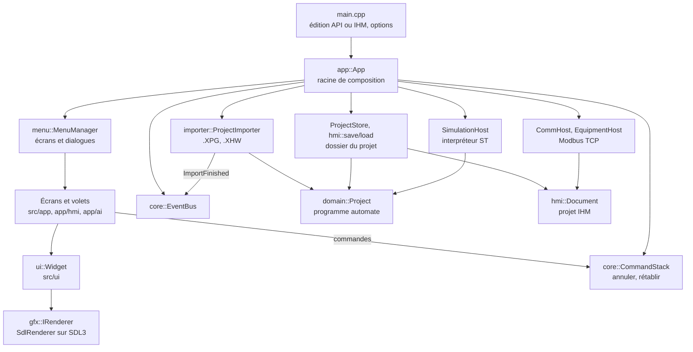
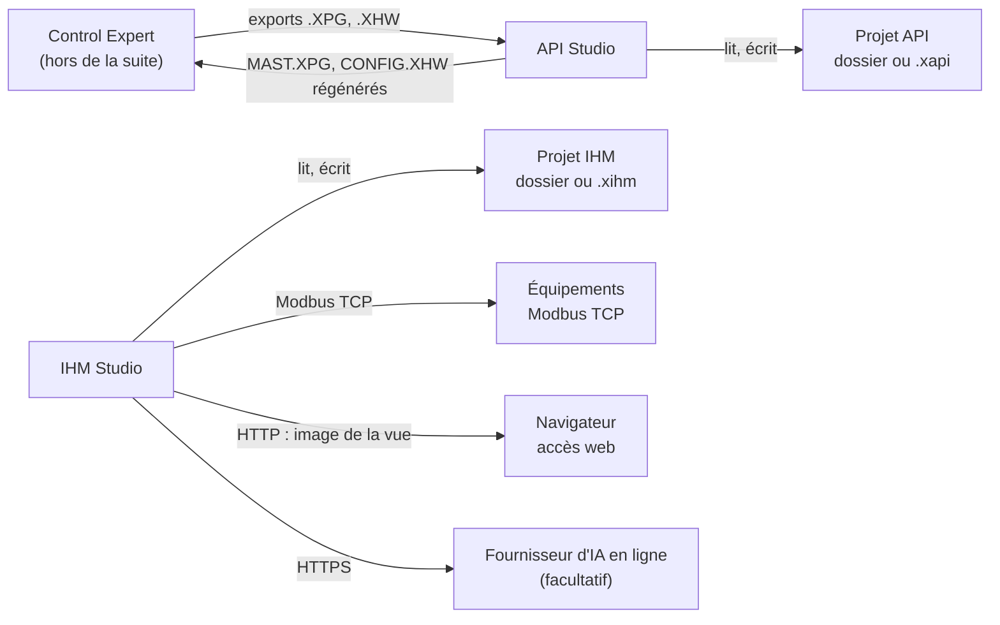

<p align="center">
  
  &nbsp;&nbsp;
  
</p>

# API IHM Studio — API Studio et IHM Studio

Suite logicielle de bureau, écrite en C++20 avec une interface maison sur SDL3, pour travailler sur des **projets d'automatisme Schneider Electric programmés avec EcoStruxure Control Expert** et sur leur **supervision** :

- **API Studio** lit les exports d'échange de Control Expert (`.XPG`, `.XHW`), range le programme dans un dossier de projet modifiable, l'analyse, le simule et régénère des fichiers à réimporter dans Control Expert ;
- **IHM Studio** conçoit, vérifie, simule et exploite une interface homme-machine (vues, alarmes, recettes, utilisateurs, équipements Modbus TCP), avec un **Assistant IA** qui propose des modifications vérifiées avant application.

Ce document est le point d'entrée de la documentation. Il décrit le code présent dans ce dépôt (**version 1.22.1**) et cite les fichiers qui justifient ses affirmations. Les détails sont dans [`docs/`](#documentation).

| | |
|---|---|
| Version | 1.22.1 (`src/core/Version.hpp`, `CMakeLists.txt`, `outils/config.ini`) |
| Applications | `API-Studio.exe` et `IHM-Studio.exe`, deux exécutables construits à partir des mêmes sources |
| Langage | C++20 ; environ 647 000 lignes dans `src/` (1 115 fichiers `.cpp`/`.hpp`/`.h`) et 147 000 dans `tests/` |
| Plates-formes livrées | Windows 10 (1809) et 11, x64 ; construction et essais automatiques sous Linux ([détail](#plates-formes)) |
| Format des projets IHM | 33 (`hmi::kFormatVersion`) |
| Essais | 121 suites CTest, toutes réussies sous Linux pour la 1.22.1 ([détail](#tests)) |

## Sommaire

1. [Présentation générale](#presentation)
2. [Fonctionnalités](#fonctionnalites)
   - [API Studio](#api-studio) · [IHM Studio](#ihm-studio) · [Fonctions communes](#communes) · [Assistant IA](#assistant-resume)
3. [Architecture technique](#architecture)
4. [Organisation du dépôt](#depot)
5. [Installation et utilisation](#installation)
6. [Compilation et développement](#compilation)
7. [Formats et données](#formats)
8. [Assistant IA : traitements locaux et externes](#assistant)
9. [Captures d'écran](#captures)
10. [Tests et qualité](#tests)
11. [Limitations connues](#limitations)
12. [Documentation](#documentation)
13. [Composants tiers et licences](#licences)

---

<a id="presentation"></a>
## 1. Présentation générale

### Deux applications, un seul code

Depuis la 1.12.0, la suite produit deux exécutables indépendants. Seul `src/main.cpp` est compilé deux fois, avec `XPG_EDITION_API` ou `XPG_EDITION_IHM` ; le reste du code interroge l'édition par `core::hasApi()` et `core::hasIhm()` (`src/core/Edition.hpp`) pour n'afficher que sa partie.

| | API Studio | IHM Studio |
|---|---|---|
| Exécutable | `API-Studio.exe` (cible CMake `xpg_api`) | `IHM-Studio.exe` (cible `xpg_ihm`) |
| Objet | Le programme de l'automate : import, analyse, édition, simulation, export vers Control Expert | L'interface de supervision : vues, alarmes, scripts, équipements, simulation, poste d'exploitation |
| Projets | `<données>/projets/api/` (`edition = api`) | `<données>/projets/ihm/` (`edition = ihm`) |
| Archive d'échange | `.xapi` | `.xihm` |
| Assistant IA | non | oui (Ctrl+Maj+I) |
| Simulation | l'automate (interpréteur ST) | l'IHM seule et ses équipements simulés |

Les deux applications ne partagent ni leurs projets, ni leurs réglages, ni leur instance ; elles partagent le dossier des données (bibliothèque, catalogue, captures), les thèmes, « Mes images » et `XPGAnalyser.ini` (`docs/LIVRAISON-1.12.0.md`, `src/app/Settings.cpp`).

### Ce que la suite n'est pas

- Elle **ne remplace pas Control Expert** : elle ne lit pas le fichier de travail binaire `.STU`, ne charge rien dans un automate, et ne modifie pas les sections LD, FBD et SFC (elle les conserve et les rend lisibles).
- IHM Studio **ne contient pas le programme de l'automate** : il se relie à l'automate comme à un équipement Modbus TCP.
- Ce n'est pas un système de sécurité : le code précise que le mécanisme des incidents de l'IHM aide à comprendre un événement et n'est pas une surveillance déterministe de la logique automate (`src/hmi/HmiIncident.hpp`).

### Domaines fonctionnels

| Domaine | API Studio | IHM Studio |
|---|:---:|:---:|
| Projets en dossier, états DEV/FINISH/LOCK, versions, archives | ✓ | ✓ |
| Import et export Control Expert (`.XPG`, `.XHW`) | ✓ | — |
| Variables, types dérivés, blocs DFB, bibliothèque partagée `libs/` | ✓ | — |
| Configuration matérielle, voies et adresses | ✓ | — |
| Sections ST, unités de programme, ordre d'exécution, GRAFCET | ✓ | — |
| Analyse, références croisées, statistiques | ✓ | — |
| Simulation et débogage du programme ST | ✓ | — |
| Macros ST, import de classeurs | ✓ | — |
| Éditeur de vues, 116 genres d'objets, symboles, popups | — | ✓ |
| Variables et types IHM, scripts et fonctions | — | ✓ |
| Alarmes, recettes, historiques, rapports, utilisateurs et sécurité | — | ✓ |
| Équipements Modbus TCP, outils réseau, équipements simulés | — | ✓ |
| Générer / Compiler, simulation de l'IHM, poste d'exploitation, accès web | — | ✓ |
| Enregistrements, incidents | — | ✓ |
| Assistant IA | — | ✓ |

### À qui s'adresse ce document

- **Utilisateur** : [§ 2 Fonctionnalités](#fonctionnalites), [§ 5 Installation et utilisation](#installation), [§ 8 Assistant IA](#assistant), puis l'aide F1 intégrée au logiciel.
- **Développeur** : [§ 3 Architecture](#architecture), [§ 4 Organisation du dépôt](#depot), [§ 7 Formats](#formats), [docs/ARCHITECTURE.md](docs/ARCHITECTURE.md).
- **Contributeur** : [§ 6 Compilation et développement](#compilation), [§ 10 Tests](#tests), [docs/GUIDE-COMPILATION.md](docs/GUIDE-COMPILATION.md), [docs/TESTS.md](docs/TESTS.md).

---

<a id="fonctionnalites"></a>
## 2. Fonctionnalités

Résumé par application ; chaque document de référence détaille où se trouve la fonctionnalité, son fonctionnement et ses limites.

<a id="api-studio"></a>
### 2.1 API Studio — [référence complète](docs/API-STUDIO.md)

| Fonctionnalité | En bref |
|---|---|
| [Projets](docs/API-STUDIO.md#projets) | Un dossier par projet (`project.xpgproj`, sections en `.st`, déclarations en tableaux texte) ; états DEV/FINISH/LOCK ; versions ; archive `.xapi`. |
| [Import](docs/API-STUDIO.md#import) | `.XPG` (programme) et `.XHW` (matériel) reconnus par leur contenu ; lecteur XML en flux ; projet publié seulement une fois analysé ; remplacement du programme d'un projet avec plan des différences. |
| [Variables](docs/API-STUDIO.md#variables) | Globales par genre, filtres, membres dépliables, usages, renommage planifié (code et tables suivent), suppression annulable, export CSV, références croisées lecture/écriture. |
| [Types et blocs](docs/API-STUDIO.md#types) | Types dérivés (DDT), blocs DFB, « qui s'en sert » ; bibliothèque partagée `libs/` (41 DFB, 41 DDT, 31 macros livrés), versions signalées et jamais appliquées d'office. |
| [Matériel](docs/API-STUDIO.md#materiel) | Racks et modules du `.XHW`, catalogue `resources/plc_catalog.txt`, contrôle des voies et adresses, plan mémoire. |
| [Programmation](docs/API-STUDIO.md#programmation) | Éditeur ST (coloration, repli, raccourcis de type Visual Studio), unités de programme, sous-routines, ordre d'exécution par glisser-déposer, comparaison de sections, tables d'animation. LD/FBD/SFC lisibles, non modifiables. |
| [GRAFCET](docs/API-STUDIO.md#grafcet) | Grafcets construits en ST et exécutés par le bloc `DFB_GRAFCETENGINE` : éditeur graphique qui réécrit le programme, contrôles, marche en simulation. |
| [Analyse](docs/API-STUDIO.md#analyse) | Tableau de bord « À regarder », constats (variables et types inutilisés, sections vides ou sans condition, adresses en double…), statistiques. |
| [Simulation](docs/API-STUDIO.md#simulation) | Interpréteur ST (sous-ensemble documenté, construction non prise en charge refusée avec la ligne), débogage (points d'arrêt, espions, pile), forçages, courbes, journal. |
| [Macros](docs/API-STUDIO.md#macros) | Macros écrites en ST qui pilotent l'éditeur ; import de classeurs `.xlsx`/`.xlsm`/CSV selon des formats déclarés une seule fois (`src/project/ImportSchema.hpp`). |
| [Exports](docs/API-STUDIO.md#exports) | Vers Control Expert (`<projet>/src/MAST.XPG` et `<projet>/src/CONFIG.XHW`), programme lisible (texte, Excel, PDF, HTML), archive `.xapi`, mode `--cli`. |

<a id="ihm-studio"></a>
### 2.2 IHM Studio — [référence complète](docs/IHM-STUDIO.md)

| Fonctionnalité | En bref |
|---|---|
| [Projets IHM](docs/IHM-STUDIO.md#projets) | Texte, un fichier par vue, écriture atomique ; format 33 au plus, écrit au plus petit format suffisant. |
| [Éditeur de vues](docs/IHM-STUDIO.md#editeur) | Bibliothèque d'objets, vue, inspecteur (Propriétés, Actions, Contenu, Code brut, Raccourcis), duplication avec repères, rechercher/remplacer, modèles de vues, paquets d'export. |
| [Objets graphiques](docs/IHM-STUDIO.md#objets) | 116 genres en 13 familles (formes, commandes, affichage, graphiques, alarmes, production, régulation, synoptique, navigation, communication, médias, enregistrements, utilisateurs). |
| [Propriétés et actions](docs/IHM-STUDIO.md#proprietes) | Valeurs et expressions animées, actions sur déclencheurs, raccourcis de vue, variables d'instance et système. |
| [Vues et symboles](docs/IHM-STUDIO.md#vues) | Vues, popups à paramètres, écrans modèles, en-têtes et pieds, symboles réutilisables. |
| [Variables et types](docs/IHM-STUDIO.md#variables) | Variables IHM (liées ou non à un équipement, rémanentes), structures, énumérations, types objets, génériques, unités de mesure, espaces de noms. |
| [Scripts et fonctions](docs/IHM-STUDIO.md#scripts) | ST exécuté par l'interpréteur de l'application ; C et C++ vérifiés en forme seulement, jamais exécutés ; tests unitaires et débogueur des fonctions. |
| [Alarmes et supervision](docs/IHM-STUDIO.md#alarmes) | Alarmes et groupes, notifications courriel (SMTP sans TLS) et SMS, recettes, historiques, rapports. |
| [Sécurité](docs/IHM-STUDIO.md#securite) | Utilisateurs, permissions, politique des mots de passe, badge, signature électronique, audit. |
| [Communication](docs/IHM-STUDIO.md#communication) | Équipements Modbus TCP et Ethernet TCP, outil Modbus (trames, lecture cyclique, espion), scanner IP, découverte, esclaves simulés. |
| [Ressources](docs/IHM-STUDIO.md#ressources) | Images, sons, vidéos, polices ; visionneuse PDF ; fichiers externes (Excel, CSV, TXT, JSON, XML, SQLite). |
| [Générer / Compiler](docs/IHM-STUDIO.md#compiler) | Cohérence du projet, compilation des expressions et scripts, constats localisés, génération incrémentale, vérification globale. |
| [Simulation](docs/IHM-STUDIO.md#simulation) | L'IHM en marche dans l'application avec ses équipements simulés. |
| [Poste et accès web](docs/IHM-STUDIO.md#poste) | Plein écran sans éditeur, kiosque, écrans secondaires, démarrage avec la session ; diffusion de l'image de la vue par HTTP. |
| [Enregistrements](docs/IHM-STUDIO.md#enregistrements) | Fichiers `.xrec` rejouables, pilotables en ligne de commande. |
| [Incidents](docs/IHM-STUDIO.md#incidents) | Dossier d'incident autonome à l'apparition d'une alarme : contexte, capture, vidéo, analyses, empreintes. |
| [Échanges](docs/IHM-STUDIO.md#echanges) | Archive `.xihm`, dossier de l'IHM en Word ou PDF, historique des modifications des objets. |

<a id="communes"></a>
### 2.3 Fonctions communes aux deux applications

| Fonction | Ce qu'elle fait | Code |
|---|---|---|
| **Projets** | Accueil : nouveau projet (Ctrl+N), ouvrir (Ctrl+O), projets récents, glisser-déposer, recherche des fichiers de l'application sur le PC (Ctrl+Maj+P). Un projet de l'autre application est refusé. | `src/app/StartPage.cpp`, `src/app/FileFinder.cpp` |
| **Enregistrement** | Ctrl+S ; écriture atomique (fichier voisin puis renommage). | `src/core/AtomicFile.hpp` |
| **États du projet** | DEV, FINISH (exigé par le poste d'exploitation), LOCK (ouverture protégée par mot de passe dans l'application ; pas un chiffrement). | `src/project/Security.hpp` |
| **Versions** | Photos nommées du projet, stockées par empreinte de contenu dans `versions/`, comparaison élément par élément, restauration précédée d'une version « Avant restauration ». | `src/hmi/HmiVersions.hpp` |
| **Format et migrations** | Format IHM 33 ; recopie unique des projets de la 1.11 au premier lancement de chaque application. | [docs/FORMATS.md](docs/FORMATS.md) |
| **Annuler / rétablir, historique** | Chaque modification est une commande (Ctrl+Z, Ctrl+Y) ; historique de la séance (Ctrl+H) ; liste « Revenir avant ». Côté IHM, historique des modifications des objets écrit à l'enregistrement. | `src/core/Command.hpp`, `src/hmi/HmiEditHistory.hpp` |
| **Recherche et navigation** | Aller à… / Faire (Ctrl+K), filtre de l'arbre (Ctrl+Maj+F), recherche du volet (Ctrl+F). | `src/app/screens/GoToWorkspace.cpp` |
| **Notifications** | Cloche de la barre du haut ; tâches de fond visibles et annulables ; notifications propres de l'Assistant IA. | `src/app/TopBar.cpp`, `src/app/BackgroundTasks.hpp` |
| **Journaux et diagnostics** | Rapport de plantage et de blocage dans `crashs/`, historique interne, « Signaler le problème » qui prépare un zip **local** (rien n'est envoyé). | `src/core/CrashGuard.hpp`, `src/help/ProblemReport.*` |
| **Reprise après arrêt brutal** | Modifications non enregistrées gardées toutes les 2 min (jamais par-dessus le projet), état du poste toutes les 10 s ; question au lancement suivant. | `src/app/Recovery.hpp` |
| **Aide** | Aide F1 contextuelle, centre d'aide, didacticiels et parcours, notes de version, table des raccourcis. | `src/help/`, `tools/guide-ihm/guide-ihm.txt` |
| **Affichage** | Disposition des panneaux, thèmes intégrés et thèmes de l'utilisateur (`.xpgtheme`), zoom (Ctrl+molette), plein écran (F11), capture (F12), plusieurs fenêtres (Ctrl+Maj+N). | `src/app/Disposition.*`, `src/ui/ThemeFile.cpp` |
| **Instance unique** | Une instance par application et par session ; un second lancement transmet ses fichiers à l'instance ouverte. | `src/core/SingleInstance.hpp` |

<a id="assistant-resume"></a>
### 2.4 Assistant IA (IHM Studio) — [référence complète](docs/ASSISTANT-IA.md)

| Aspect | En bref |
|---|---|
| Fournisseurs | **IA intégrée** (à règles, sans connexion, par défaut sur une installation neuve), **Démonstration**, **Anthropic (Claude)** ou relais d'entreprise, **compatible OpenAI** (Ollama, LM Studio, OpenRouter, Groq, Google Gemini, Mistral, autre). |
| Clés API | Gestionnaire de clés nommées ; clé protégée par DPAPI sous Windows, gardée pour la séance seulement sous Linux ; jamais écrite en clair. |
| Conversations | Un fichier JSON par conversation dans le dossier `IA/` des réglages, jamais dans le projet. |
| Propositions d'opérations | Créer, modifier, associer, aligner, distribuer, dupliquer, supprimer des objets ; créer vues, symboles, popups, variables, types, équipements, scripts, fonctions, alarmes ; suppression intelligente. Rien n'est inventé : genre, propriété et variable doivent exister. |
| Prévisualisation, application, Undo/Redo | Validation sur une copie, fenêtre « Prévisualisation des modifications », **Appliquer** en une seule commande (un Ctrl+Z), application en fond au-delà de 40 opérations, mode Direct, refus réversible. |
| Plan et compte rendu | Étapes triées par dépendances, compte rendu lu dans le projet après application. |
| Propositions successives | Une grande demande est découpée ; la carte affiche « Suite prévue » et le bouton **Proposer la suite** (1.21.3). |
| Missions IA persistantes | Une grande demande devient une **mission** (1.22.0) : analyse du projet réel, plan d'étapes ordonnées par leurs dépendances, propositions successives P1, P2… qui savent ce qui a réellement été fait, progression calculée (par étape depuis la 1.22.1 : son pourcentage, ce qu'elle fait en ce moment, son journal), tableau de bord, reprise après une fermeture sans rien rejouer, audit et rapport final. Fichiers `IA/missions/<id>.json`. |
| Pièces jointes | Textes découpés à la mesure du modèle, lecture exacte de lignes à la demande (`lire_piece_jointe`, 8 lectures au plus), classeurs reconnus et modèles de fichiers. |
| Apprentissage local | Connaissances, modèles métier et vocabulaire de l'IA intégrée, souvenirs validés par l'utilisateur, export `.xia`. **Aucun modèle n'est entraîné ou réentraîné.** |
| Notifications | Onglet Notifications du panneau (300 au plus). |

---

<a id="architecture"></a>
## 3. Architecture technique

Résumé ; le détail (bibliothèques CMake, fils d'exécution, persistance, erreurs, chaîne d'import, Assistant IA) est dans [docs/ARCHITECTURE.md](docs/ARCHITECTURE.md).

- **Langage et compilation** : C++20, CMake ≥ 3.24 ; sources ramassées par dossier (`xpg_sources()`), sans liste manuelle. Projet Visual Studio équivalent (`XpgAnalyzer.sln`, `XpgAnalyzer.vcxproj`).
- **Séparation** : les modèles et la persistance ne dépendent pas de l'écran — `domain::Project` (programme automate), `project::ProjectStore` (dossier du projet), `hmi::Project` (modèle IHM : « le modèle ne sait rien de l'écran »), `sim::` (interpréteur ST). L'interface est dans `src/app`, `src/ui`, `src/menu`, `src/platform`.
- **Interface maison** : arbre de widgets `ui::Widget` (mise en page, dessin, événements capture/cible/remontée), pile d'écrans `menu::MenuManager` (écrans, modales, dialogues, calques ; navigation différée), thèmes, zoom.
- **Rendu** : interface `gfx::IRenderer` ; une seule implémentation à l'écran, `SdlRenderer`, sur le `SDL_Renderer` de SDL3 (pilote de rendu choisi par SDL) ; texte rasterisé par `stb_truetype` (`FontAtlas`) ; `SvgRenderer` pour les exports SVG.
- **Événements et commandes** : `core::EventBus` (publication différée, livrée sur le fil de l'interface), `core::Signal`, `core::CommandStack` (annulation, groupes, fusion des frappes).
- **Fils d'exécution** : un seul fil pour l'interface et les modèles ; import, génération de l'IHM, communication, serveur web, notifications, recherche de fichiers et fournisseurs d'IA travaillent sur des fils de fond que l'écran interroge à chaque image.
- **Assistant IA** : fournisseurs sur un fil de travail, `poll()` à chaque image ; appel d'outil → proposition → validation sur copie → plan → aperçu → une commande → compte rendu.



Contexte d'utilisation :



---

<a id="depot"></a>
## 4. Organisation du dépôt

```text
.
├── CMakeLists.txt            construction de référence (bibliothèques, deux exécutables, essais)
├── XpgAnalyzer.sln/.vcxproj  projet Visual Studio équivalent (contrôlé par outils/verifier_vcxproj.py)
├── src/                      sources C++ (voir le tableau ci-dessous)
├── tests/                    suites d'essais (*_test.cpp) et données d'essai (fixtures/)
├── libs/                     bibliothèque livrée : DFB, DDT (Alarms, Client, Comm, Control, Equipment, IO, Measure, System), macros (Macros/)
├── resources/                catalogue matériel, catalogue des blocs Control Expert, logos, ressources Windows (.rc, manifeste)
├── third_party/              stb, nanosvg, minimp3, miniz ; en-têtes SDL3 ; origine de PDFium
├── outils/                   scripts de fabrication Windows (.bat + lib/*.ps1), config.ini, MinGW, PDFium, générateurs
├── installateur/             script Inno Setup (XPGAnalyser.iss), images, polices, aide de la liste Windows, lanceur du poste
├── tools/                    source de l'aide F1, générateurs (images, logo, tutoriels), séances de capture, banc réseau, prévisualisations
├── docs/                     documentation, notes de livraison, maquettes HTML, classeur d'accompagnement
├── aide/                     fiches d'aide en texte des blocs et macros de la bibliothèque
├── bac/                      projet modèle livré à côté de l'exécutable (didacticiels, essais)
├── projets/                  projet d'exemple d'avant la 1.12, programme et IHM ensemble (essai hmidecl)
└── dist/                     empreinte SHA-256 du dernier installateur fabriqué
```

| Dossier `src/` | Rôle | Bibliothèque CMake |
|---|---|---|
| `core/` | Résultats et erreurs, signaux, bus d'événements, commandes et annulation, écriture atomique, plantages, instance unique, processus enfants, édition et version | `xpg_core` |
| `xls/` | Lecture des classeurs `.xlsx`/`.xlsm` | `xpg_xls` |
| `domain/`, `import/`, `export/`, `project/`, `sim/` | Modèle du programme automate, import `.XPG`/`.XHW` et analyse, écritures `.XPG` et programme lisible, projet sur disque et commandes, interpréteur ST | `xpg_import` |
| `ui/`, `menu/` | Cadre d'interface maison (widgets, mises en page, thèmes, icônes) et pile d'écrans | `xpg_ui` |
| `help/` | Centre d'aide, aide F1, raccourcis, notes de version, didacticiels | `xpg_help` |
| `hmi/` | Modèle IHM, fichiers, commandes, vérifications, moteur d'exécution, communication, incidents, enregistrements | `xpg_hmi` |
| `platform/` | Rendu (`IRenderer`, `SdlRenderer`), polices, événements | dans `xpg_app` |
| `app/` (`ai/`, `hmi/`, `screens/`, `tutorial/`) | Application : écrans, volets, éditeur de vues, Assistant IA, réglages, dossiers, reprise | `xpg_app` (bibliothèque d'objets) |
| `main.cpp` | Point d'entrée des deux exécutables | `xpg_api`, `xpg_ihm` |

Remarques sur la racine : `build.sh` et `runtests.sh` sont des scripts historiques (voir [§ 10](#tests)) ; `Aide-2026-09-21.html` est une page HTML « Aide de la bibliothèque » exportée, `lot21.patch` un fichier de différences conservé tel quel et `XpgAnalyzer.lnk` un raccourci Windows : aucun de ces trois fichiers n'est utilisé par la construction ni par les scripts de fabrication.

---

<a id="installation"></a>
## 5. Installation et utilisation

<a id="plates-formes"></a>
### Plates-formes

| Plate-forme | État |
|---|---|
| **Windows 10 (1809, 10.0.17763) et 11, x64** | Plate-forme des exécutables livrés (`MinVersion`, `ArchitecturesAllowed=x64compatible` dans `installateur/XPGAnalyser.iss`). Les exécutables et l'installateur des dernières versions ont été vérifiés **sous Wine, pas sur un vrai Windows** (notes de livraison 1.21.x). |
| **Linux x64** | Construction des bibliothèques, des essais et du mode `--cli` (essais : 116 suites réussies). L'interface graphique sous Linux exige SDL3 ; elle n'est pas livrée et n'est pas vérifiée pour les versions actuelles. Le code comporte des branches Linux (réglages XDG, libcurl, libpcap, démarrage du poste par `~/.config/autostart`). |
| macOS | Non pris en charge par la construction ni les scripts (seuls des chemins de polices macOS figurent dans `FontAtlas.cpp`). |

### Installer (Windows)

1. Lancer **`API-IHM-Studio-Setup-<version>.exe`** (installateur Inno Setup, non signé : SmartScreen peut avertir). Empreinte : `dist/SHA256SUMS.txt`.
2. Choisir pour qui (moi seul, sans droits d'administrateur ; ou tous les comptes), ce qui est installé (**les deux**, **API Studio seul**, **IHM Studio seul**, **poste d'exploitation**), le dossier des données (`Documents\XPGAnalyser` par défaut), la bibliothèque, le réglage initial de l'Assistant IA et les options (raccourcis, associations `.xapi`/`.xihm`, « Ouvrir avec API Studio » pour les `.XPG`, pare-feu, copie de secours pour Réparer).
3. Maintenance installée dans le menu Démarrer (vérifier, réparer, reprendre, restaurer, réinitialiser, collecter les journaux).

Procédure complète, installation sans surveillance, mise à jour, réparation, désinstallation : [docs/GUIDE-INSTALLATION.md](docs/GUIDE-INSTALLATION.md).

### Versions portables

`API-Studio-<version>-portable.zip` et `IHM-Studio-<version>-portable.zip` : à décompresser et lancer. Sans `installation.ini` à côté de l'exécutable, l'application range projets, bibliothèque, ressources et captures dans son dossier de travail (ou celui de l'exécutable s'il contient `resources\`) — `src/app/Dossiers.hpp`.

### Premier démarrage

- Un fichier de réglages par application est créé (`%APPDATA%\XpgAnalyzer\API\settings.txt` ou `\IHM\settings.txt`) ; au premier lancement d'une application, les projets de la 1.11 éventuels sont recopiés dans son rangement (les originaux restent).
- L'écran d'accueil propose : **Nouveau projet** (Ctrl+N), **Ouvrir…** (Ctrl+O), les projets récents, **Dossiers**, les premiers pas et le didacticiel ; dans IHM Studio, **Poste d'exploitation** et **Démarrage auto…**.
- Une version installée demande une fois à Windows d'épingler l'application à la barre des tâches si l'option a été cochée.

### Créer, ouvrir, enregistrer un projet

| Action | API Studio | IHM Studio |
|---|---|---|
| Créer | **Nouveau projet** : un projet vide avec une tâche MAST, ou **Ouvrir** un `.XPG` puis « Créer un projet à partir de cet export » | **Nouveau projet IHM** : un dossier, un manifeste et une vue de démarrage |
| Ouvrir | Dossier de projet (`project.xpgproj`), archive `.xapi`, export `.XPG` (lecture seule si aucun projet n'est créé) ; `.XHW` dans le projet ouvert par Ctrl+Maj+O | Dossier de projet IHM ou archive `.xihm` |
| Enregistrer | Ctrl+S | Ctrl+S |
| Échanger | **Projet › Exporter en archive .xapi…** / **Importer une archive…** | **Projet › Exporter en archive .xihm…** / **Importer une archive…** |

<a id="cli"></a>
### Ligne de commande

Options lues par `src/main.cpp` :

| Option | Effet |
|---|---|
| `<fichier>` | Ouvre le projet, l'archive ou l'export donné (transmis à l'instance déjà ouverte s'il y en a une). |
| `--version` | Écrit le nom et la version (`API Studio 1.22.1` ou `IHM Studio 1.22.1`) et s'arrête. |
| `--cli <fichier.XPG> [autres]` | API Studio : analyse sans fenêtre ; code 0 sans constat d'erreur, 1 sinon, 2 si la lecture échoue. |
| `--poste <dossier>` ou `--ihm <dossier>` | IHM Studio : ouvre le projet en poste d'exploitation. |
| `--enregistrer`, `--rejouer`, `--arreter-enregistrement`, `--quitter-relecture` (+ `--duree`, `--vitesse`, `--mot-de-passe`, `--jeter`) | IHM Studio : pilote les enregistrements d'une IHM en marche ([détail](docs/IHM-STUDIO.md#enregistrements)). |
| `--nouvelle-fenetre` | Ouvre une fenêtre de plus (utilisé par Ctrl+Maj+N). |
| `--light`, `--size <L>x<H>` | Thème clair au lancement ; taille de fenêtre imposée. |
| `--script <séance>`, `--captures <dossier>` | Rejoue une séance scriptée (captures des livraisons, vérifications). |
| `--verifier-tutoriels`, `--verifier-tutoriel <clé>`, `--verifier-sujets`, `--verifier-dossier <dossier>`, `--bilan <fichier>`, `--tutoriel-texte`, `--compter-tutoriels` | Vérification des didacticiels. |
| `--essai-plantage`, `--essai-blocage`, `--sans-historique` | Essais du rapport de plantage et de blocage ; désactivation de l'historique interne. |
| `--bac-a-sable` | Interne : processus enfant du bac à sable de l'Assistant IA (IHM Studio). |

Variables d'environnement : `XPG_INSTANCES_MULTIPLES=1` (plusieurs instances), `XPG_PDFIUM` (emplacement de PDFium), `XPG_BAC_SOURCES` (source du projet des didacticiels).

### Emplacements des données

| Quoi | Windows (installation) |
|---|---|
| Programme | `%LOCALAPPDATA%\Programs\API IHM Studio` ou `C:\Program Files\API IHM Studio` |
| Données (projets `projets\api`, `projets\ihm`, `libs\`, `resources\`, `captures\`) | `Documents\XPGAnalyser` (modifiable : accueil › Dossiers) |
| Réglages partagés (`XPGAnalyser.ini`, `themes\`, `images\`, `IA\`) | `%APPDATA%\XpgAnalyzer` |
| Réglages d'une application (`settings.txt`, `crashs\`, `signalements\`, `reprise\`, `modeles-vues\`) | `%APPDATA%\XpgAnalyzer\API` ou `\IHM` |
| État, journaux, sauvegardes, réserve de l'installation | `%LOCALAPPDATA%\XpgAnalyzer` ou `%ProgramData%\XPGAnalyser` |

Sous Linux, les réglages sont dans `$XDG_CONFIG_HOME/xpg-analyzer` (par défaut `~/.config/xpg-analyzer`). Détail et justification : [docs/FORMATS.md](docs/FORMATS.md#emplacements), [docs/CONFIG-INI.md](docs/CONFIG-INI.md).

---

<a id="compilation"></a>
## 6. Compilation et développement

Guide complet : [docs/GUIDE-COMPILATION.md](docs/GUIDE-COMPILATION.md).

### Prérequis

- Compilateur C++20 : GCC (13.x dans l'environnement des livraisons récentes), MinGW-w64 GCC variante `posix` pour l'exécutable Windows croisé, ou MSVC v143 (Visual Studio 2022 / Build Tools) ; CMake ≥ 3.24 et Ninja ; Python 3.
- **SDL3 3.4.12** : seuls les en-têtes sont dans le dépôt ; `SDL3.dll`/`SDL3.lib` du paquet officiel vont dans `third_party/SDL3/lib/x64/` pour les constructions Windows et MinGW (`third_party/SDL3/ORIGINE.txt`).
- **PDFium** (facultatif à l'exécution, nécessaire à l'essai `hmidocviewer`) : `python3 outils/pdfium/obtenir_pdfium.py`.
- **Inno Setup ≥ 6.3** pour l'installateur.

### Linux : construire et essayer

```bash
python3 outils/pdfium/obtenir_pdfium.py                  # une fois
cmake -S . -B build-linux -G Ninja -DXPG_WITH_SDL=OFF
ninja -C build-linux
ctest --test-dir build-linux --output-on-failure
```

`-DXPG_WITH_SDL=OFF` construit tout sans SDL : les exécutables n'ouvrent pas de fenêtre mais `--cli` et `--version` fonctionnent. La compilation de `src/hmi/HmiGuideText.cpp` (aide F1 générée) demande beaucoup de mémoire : limiter le parallélisme si nécessaire.

### Windows : exécutables

```bash
# Sous Linux, compilation croisée (exécutables livrés) : build-mingw/API-Studio.exe et IHM-Studio.exe
outils/mingw/cross_mingw.sh
```

```bat
rem Sous Windows, avec MSVC : build\Release\API-Studio.exe et IHM-Studio.exe
outils\build.bat
```

Dans Visual Studio, `XpgAnalyzer.sln` construit l'édition choisie par la propriété `XpgEdition` (`API` par défaut, ou `IHM`). La version de `resources/windows/xpg_analyzer.rc` est alignée sur les trois autres depuis la 1.22.0 (elle était restée à 1.12.0) ; `build.bat` la vérifie ([détail](docs/GUIDE-COMPILATION.md#version)). Aucune compilation MSVC n'a été faite dans les sessions de la 1.22.0 et de la 1.22.1.

### Installateur et versions portables

```bash
# Sous Linux (Inno Setup sous Wine) : API-IHM-Studio-Setup-<version>.exe à la racine, zips portables dans DOSSIER
python3 outils/mingw/package_mingw.py --iscc /chemin/vers/ISCC.exe --portables DOSSIER
```

```bat
rem Sous Windows : compilation, essais, dist\staging, installateur
outils\package.bat
```

### Contribuer : règles du dépôt

- **Sources** : un fichier ajouté sous `src/<dossier>/` est compilé automatiquement par CMake ; il doit aussi être nommé dans `XpgAnalyzer.vcxproj` (`python3 outils/verifier_vcxproj.py --corriger`), sans quoi l'essai `vcxproj` échoue. Les sources restent en ASCII : les textes accentués de l'interface sont écrits en UTF-8 échappé (`"\xC3\xA9"`).
- **Essais** : chaque suite est déclarée explicitement dans `CMakeLists.txt` (`xpg_add_test_executable`, `xpg_add_test`) ; voir [docs/TESTS.md](docs/TESTS.md).
- **Aide F1** : modifier `tools/guide-ihm/guide-ihm.txt`, puis régénérer `src/hmi/HmiGuideText.cpp` par `python3 tools/guide-ihm/generer_guide.py --cpp src/hmi/HmiGuideText.cpp` (ne pas modifier le C++ généré à la main).
- **Fichiers générés** : `src/hmi/HmiNativesData.cpp` (`outils/natives/generer.py`), `src/hmi/HmiImageLibraryData.cpp` (`tools/images/generer_images.py`), `src/core/CodeStats.hpp` (`outils/compter_lignes.py`).
- **Version** : identique dans `CMakeLists.txt`, `src/core/Version.hpp`, `resources/windows/xpg_analyzer.rc` et `outils/config.ini`.
- **Notes de version** : table des notes affichées dans l'application, `src/help/ReleaseNotes.cpp` ; une note de livraison par version dans `docs/LIVRAISON-<version>.md`.
- **Format des projets IHM** : toute donnée nouvelle qui ne peut pas être relue par une version antérieure augmente `hmi::kFormatVersion` (règle décrite dans `src/hmi/HmiStore.hpp`).

---

<a id="formats"></a>
## 7. Formats et données

Référence complète : [docs/FORMATS.md](docs/FORMATS.md).

| Extension | Rôle | Application |
|---|---|---|
| `project.xpgproj` | Manifeste d'un dossier de projet | les deux |
| `.xapi` / `.xihm` | Archive d'un projet (zip, manifeste, empreintes SHA-256, contrôle de cohérence à l'ouverture) | API Studio / IHM Studio |
| `.XPG`, `.XHW` | Exports Control Expert lus et écrits | API Studio |
| `.XDB`, `.XEF`, `.ZEF`, `.STU` | Non importés dans ce commit (lecteur non implémenté, aucun lecteur, ou refus explicite) | — |
| `.st`, `.vue`, `ihm.txt` | Code des sections ; vues et index du projet IHM (texte terminé par `fin`) | API / IHM |
| `.dfb`, `.ddt`, `.mac`, `libs/index.txt` | Bibliothèque partagée et macros | API Studio |
| `.xpgvues`, `.xpgsymboles`, `.xpgtypes`, `.xpgfonctions`, `.xpgscripts`, `.xpgst`, `.xpgmodele`, `.xpgbib` | Paquets d'export de l'IHM | IHM Studio |
| `.xrec` | Enregistrement de l'IHM en marche | IHM Studio |
| `.xia` | Apprentissage de l'Assistant IA, transportable d'un PC à l'autre | IHM Studio |
| `.xpgtheme` | Thème de l'utilisateur | les deux |
| `.xlsx`, `.xlsm`, `.csv` | Classeurs d'entrée (import, fichiers externes, pièces jointes) ; macros VBA jamais exécutées | les deux |
| `.xpglayout` | Disposition manuelle des grafcets | API Studio |

- **Format interne des projets IHM** : 33 (`hmi::kFormatVersion`), écrit au plus petit format suffisant ; un outil plus ancien refuse un format plus récent. La 1.22.0 ne change pas ce format : les missions IA sont des fichiers à part, dans le dossier `IA/missions/` des réglages, jamais dans le projet.
- **Sauvegardes** : sauvegarde de la version installée avant mise à jour (3 gardées), réserve de réparation (`Reserve\<version>`), reprise après arrêt brutal, sauvegardes de la mémoire de l'Assistant, version « Avant restauration ».
- **Données de l'Assistant** : dossier `IA/` (conversations, pièces jointes, `parametres.json` sans clé, `notifications.json`, `cles/` protégées par DPAPI sous Windows…) — [docs/ASSISTANT-IA.md](docs/ASSISTANT-IA.md#donnees).

---

<a id="assistant"></a>
## 8. Assistant IA : traitements locaux et externes

Référence complète : [docs/ASSISTANT-IA.md](docs/ASSISTANT-IA.md).

| Reste sur le PC | Part chez un fournisseur externe (Anthropic ou service compatible OpenAI en ligne) |
|---|---|
| Toute l'IA intégrée et la démonstration | La demande et **la conversation entière** |
| Validation, plan, aperçu, application, annulation | Les consignes, le registre des genres d'objets, le texte des connaissances actives |
| Extraction du texte des pièces jointes, lecture exacte de lignes, bac à sable, analyse du projet | Selon les cases de confidentialité (cochées par défaut) : la vue active et ses objets, la sélection, les noms et types des variables, les pièces jointes ou leur texte extrait |
| Conversations, mémoire, souvenirs, modèles de fichiers, clés (dans `IA/`) | Le résultat des outils locaux appelés par l'IA |

Un modèle servi sur le PC (Ollama, LM Studio) reçoit les mêmes données sans qu'elles quittent la machine. Points essentiels :

- l'Assistant **n'existe que dans IHM Studio** ;
- **aucun modèle n'est entraîné ni réentraîné** : l'« apprentissage » est une mémoire locale (connaissances, modèles métier et vocabulaire de l'IA intégrée, modèles de fichiers, souvenirs) relue et jointe aux demandes ;
- la clé API n'est jamais écrite en clair ; sous Linux elle n'est gardée que pour la séance ;
- `http://` n'est accepté que vers le poste lui-même, ou vers une adresse privée pour un service compatible OpenAI sans clé ;
- limites : qualité dépendante du modèle, essais automatiques faits avec un faux fournisseur (aucun essai avec une vraie IA rapporté pour la 1.22.0 ni la 1.22.1), bac à sable non isolé du réseau sous Windows, C/C++ jamais exécutés, PDF scannés et `.xls` non lus.

---

<a id="captures"></a>
## 9. Captures d'écran

Le dépôt ne contient **aucune capture d'écran du logiciel** : les images de `installateur/images/` habillent l'installateur, les pages de `docs/maquettes/` sont des maquettes HTML de conception, et les captures citées par l'aide F1 sont produites hors du dépôt. Seuls les logos (`resources/logo/`) sont utilisés ici.

Les emplacements prévus, le contenu attendu de chaque capture et la façon de les produire (F12, séances rejouées avec `--script` et `--captures`) sont listés dans [docs/images/README.md](docs/images/README.md).

---

<a id="tests"></a>
## 10. Tests et qualité

Détail : [docs/TESTS.md](docs/TESTS.md).

- **119 suites CTest** dans ce commit : 118 essais C++ enregistrés par `xpg_add_test` (certains exécutables servent à deux essais) et l'essai Python `vcxproj`. Répartition : Assistant IA (21), IHM (37), automate (33), socle et application (27), outillage (1). Vingt-deux autres suites sont déclarées mais sautées car leur source n'est pas dans le dépôt.
- Les essais n'ouvrent pas de fenêtre ; réseau et IA sont remplacés par des faux injectables.
- **Plates-formes réellement essayées** : Linux (CTest, 121 suites réussies pour la 1.22.1) ; les exécutables Windows ont été vérifiés **sous Wine, pas sur un vrai Windows** (`--version`, `--cli` sur le projet d'essai, installation silencieuse, bac à sable).
- `build.sh` et `runtests.sh` sont historiques (le premier se déclare « plus tenu à jour ») : la référence est CMake/CTest.
- Des essais réussis ne prouvent pas l'absence de défauts ; l'interface graphique réelle, les services d'IA réels, Windows hors Wine et les automates physiques ne sont pas couverts par les essais automatiques.

---

<a id="limitations"></a>
## 11. Limitations connues

Relevées dans le code et les notes de livraison de ce commit :

- **Import** : `.XEF`/`.ZEF` reconnus mais non lus (import en échec) ; `.XDB` non implémenté ; `.STU` refusé.
- **Programme** : sections LD, FBD, SFC conservées et lisibles, ni modifiables ni simulées ; la simulation couvre un sous-ensemble du ST et refuse le reste avec un diagnostic.
- **Sécurité des projets** : LOCK bloque l'ouverture dans l'application mais ne chiffre pas le dossier ; la clé maîtresse dérivée d'une adresse MAC n'est pas une frontière de sécurité.
- **IHM** : communication Modbus TCP seulement (et surveillance « joignable » d'un appareil Ethernet) ; scripts C/C++ jamais exécutés ; courriel sans TLS ; accès web en HTTP ; vidéo MP4/WMV/MOV sous Windows seulement ; bases de données externes par chaîne de connexion non connectées.
- **Assistant IA** : IHM Studio seulement ; voir [§ 8](#assistant) et [docs/ASSISTANT-IA.md](docs/ASSISTANT-IA.md#limites).
- **Plates-formes** : pas d'exécutable graphique Linux livré ; vérifications Windows faites sous Wine seulement ; installateur non signé.
- **Fabrication Windows MSVC** : aucune compilation MSVC n'est rapportée par les notes de livraison récentes (la version du `.rc`, restée à 1.12.0, a été alignée en 1.22.0).
- **Missions IA** : IHM Studio seulement ; essayées avec un faux fournisseur, jamais avec une vraie IA ; voir [docs/LIVRAISON-1.22.0.md](docs/LIVRAISON-1.22.0.md).
- **Dépôt** : `SDL3.dll`/`SDL3.lib` et PDFium ne sont pas versionnés ; 22 suites d'essais déclarées n'ont pas leur source.

Aucune feuille de route n'est publiée dans ce dépôt.

---

<a id="documentation"></a>
## 12. Documentation

| Document | Contenu |
|---|---|
| [docs/API-STUDIO.md](docs/API-STUDIO.md) | Référence fonctionnelle d'API Studio |
| [docs/IHM-STUDIO.md](docs/IHM-STUDIO.md) | Référence fonctionnelle d'IHM Studio |
| [docs/ASSISTANT-IA.md](docs/ASSISTANT-IA.md) | Assistant IA : fournisseurs, données, opérations, mémoire, limites |
| [docs/ARCHITECTURE.md](docs/ARCHITECTURE.md) | Architecture technique |
| [docs/FORMATS.md](docs/FORMATS.md) | Formats, données, emplacements, migrations |
| [docs/TESTS.md](docs/TESTS.md) | Essais et qualité |
| [docs/GUIDE-COMPILATION.md](docs/GUIDE-COMPILATION.md) | Compilation Linux, MinGW, Windows ; installateur ; outils |
| [docs/GUIDE-INSTALLATION.md](docs/GUIDE-INSTALLATION.md) | Installer, mettre à jour, réparer, désinstaller |
| [docs/CONFIG-INI.md](docs/CONFIG-INI.md) | `outils/config.ini`, `installation.ini`, `XPGAnalyser.ini` |
| [docs/DEPANNAGE.md](docs/DEPANNAGE.md) | Dépannage |
| [docs/images/README.md](docs/images/README.md) | Captures à ajouter |
| Aide F1 (dans le logiciel) | Mode d'emploi écran par écran ; source `tools/guide-ihm/guide-ihm.txt` |

Documents historiques, conservés tels quels : notes de livraison `docs/LIVRAISON-<version>.md` (de la 1.11.3 à la 1.22.0 ; la plus récente est [docs/LIVRAISON-1.22.0.md](docs/LIVRAISON-1.22.0.md), avec l'audit fait avant les missions : [docs/AUDIT-MISSIONS-1.22.0.md](docs/AUDIT-MISSIONS-1.22.0.md)), audit de conception de l'Assistant IA ([docs/ASSISTANT-IA-AUDIT.md](docs/ASSISTANT-IA-AUDIT.md)), audit de la bibliothèque d'objets ([docs/AUDIT-BIBLIOTHEQUE-OBJETS.md](docs/AUDIT-BIBLIOTHEQUE-OBJETS.md)), rapports ([docs/RAPPORT-ANALYSE.md](docs/RAPPORT-ANALYSE.md), [docs/RAPPORT-FINAL-IHM-SIMULATION.md](docs/RAPPORT-FINAL-IHM-SIMULATION.md), [docs/REFONTE-SCRIPTS-ANALYSE.md](docs/REFONTE-SCRIPTS-ANALYSE.md)), notes de travail `docs/NOTES-*.md`, maquettes HTML `docs/maquettes/`, classeur d'accompagnement (`docs/automation.xlsx`, `docs/automation.xlsm`, `docs/Automation.bas`, `docs/make_workbook.py`, `docs/GUIDE.txt`). Ces documents décrivent l'état du logiciel à leur date.

---

<a id="licences"></a>
## 13. Composants tiers et licences

Le dépôt ne contient pas de fichier de licence pour le code du projet lui-même. Composants tiers et leurs licences :

| Composant | Usage | Licence (fichier) |
|---|---|---|
| SDL3 3.4.12 | Fenêtre, rendu, événements, son | zlib (`third_party/SDL3/LICENSE.txt`) |
| miniz | Zip (archives, classeurs) | `third_party/miniz.LICENSE` |
| nanosvg | SVG | `third_party/nanosvg.LICENSE` |
| minimp3 | MP3 | `third_party/minimp3.LICENSE` |
| stb_truetype, stb_image, stb_image_write | Polices, images | domaine public ou MIT, au choix (texte de licence dans chaque en-tête `third_party/stb_*.h`) |
| PDFium 156.0.8076.0 (non versionné) | PDF | BSD-3-Clause / Apache-2.0, licences posées par `obtenir_pdfium.py` (`third_party/pdfium/ORIGINE.txt`) |
| Police Barlow (installateur) | Habillage de l'installateur | SIL OFL (`installateur/polices/OFL-Barlow.txt`) |
