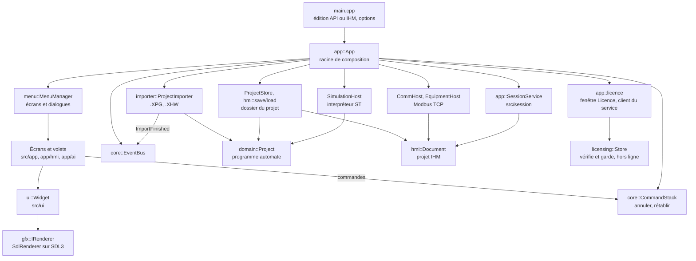
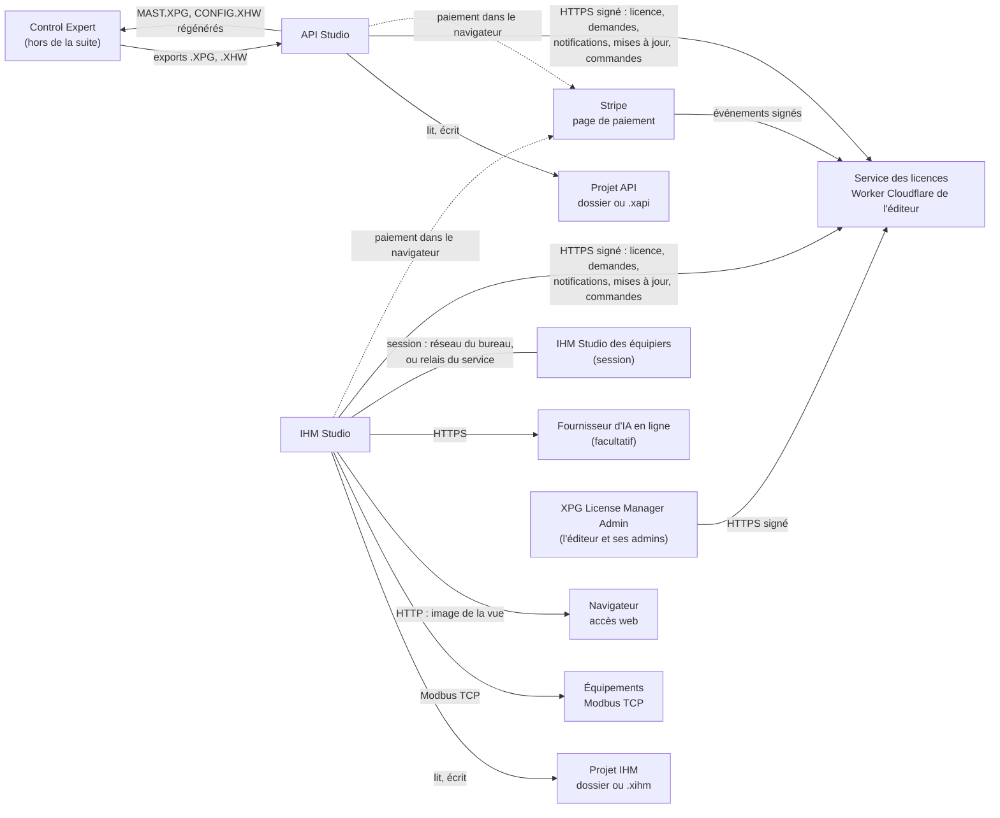

<p align="center">
  
  &nbsp;&nbsp;
  
</p>

# API IHM Studio — API Studio et IHM Studio

Suite logicielle de bureau, écrite en C++20 avec une interface maison sur SDL3, pour travailler sur des **projets d'automatisme Schneider Electric programmés avec EcoStruxure Control Expert** et sur leur **supervision** :

- **API Studio** lit les exports d'échange de Control Expert (`.XPG`, `.XHW`), range le programme dans un dossier de projet modifiable, l'analyse, le simule et régénère des fichiers à réimporter dans Control Expert ;
- **IHM Studio** conçoit, vérifie, simule et exploite une interface homme-machine (vues, alarmes, recettes, utilisateurs, équipements Modbus TCP), avec un **Assistant IA** qui propose des modifications vérifiées avant application ; plusieurs PC peuvent y travailler ensemble sur le même projet (les **sessions**).

Autour des deux Studios, le dépôt contient aussi **les licences** : la fenêtre Licence des Studios, l'outil de l'éditeur **XPG License Manager Admin** (jamais livré aux clients) et le **service des licences**, un Worker Cloudflare que l'éditeur met en ligne sur son propre compte (demandes et activation des licences, notifications, mises à jour, sessions par Internet, boutique en ligne avec Stripe).

Ce document est le point d'entrée de la documentation. Il décrit le code présent dans ce dépôt (**version 1.46.0**) et cite les fichiers qui justifient ses affirmations. Les détails sont dans [`docs/`](#documentation).

> **1.47.0 en préparation, non livrée.** La branche contient déjà du travail en cours pour la 1.47.0 (statistiques, courbes et globe de l'Admin, filtres des listes…). Ce travail n'est pas livré et n'est pas décrit ici, hormis sa conception citée au [§ 12](#documentation) ([docs/STATISTIQUES.md](docs/STATISTIQUES.md)) ; les fichiers de version du dépôt restent à 1.46.0.

| | |
|---|---|
| Version | 1.46.0 (`src/core/Version.hpp`, `CMakeLists.txt`, `resources/windows/xpg_analyzer.rc`, `outils/config.ini`), livrée le 10/11/2026 ([note de livraison](docs/LIVRAISON-1.46.0.md)) |
| Applications | `API-Studio.exe` et `IHM-Studio.exe`, deux exécutables construits à partir des mêmes sources ; pour l'éditeur seul, `XPG-License-Manager-Admin.exe` et sa console `XPG-License-Admin.exe` ([§ 1](#autres-programmes)) |
| Service | `service/` : le service des licences, un Worker Cloudflare en JavaScript avec ses Durable Objects SQLite ([§ 2.7](#service)) |
| Langage | C++20 ; environ 804 000 lignes dans `src/` (1 334 fichiers `.cpp`/`.hpp`/`.h`) et 196 000 dans `tests/` ; JavaScript pour le service (environ 5 100 lignes dans `service/src/`, 3 600 dans `service/test/`) |
| Plates-formes livrées | Windows 10 (1809) et 11, x64 ; construction et essais automatiques sous Linux ([détail](#plates-formes)) |
| Format des projets IHM | 33 (`hmi::kFormatVersion`, `src/hmi/HmiStore.hpp`) |
| Essais | 175 suites CTest, toutes réussies sous Linux pour la 1.46.0 ([détail](#tests)) |

## Sommaire

1. [Présentation générale](#presentation)
2. [Fonctionnalités](#fonctionnalites)
   - [API Studio](#api-studio) · [IHM Studio](#ihm-studio) · [Fonctions communes](#communes) · [Assistant IA](#assistant-resume) · [Licences et achats](#licence-studios) · [L'Admin de l'éditeur](#admin-editeur) · [Le service des licences](#service)
3. [Architecture technique](#architecture)
4. [Organisation du dépôt](#depot)
5. [Installation et utilisation](#installation)
6. [Compilation et développement](#compilation)
7. [Formats et données](#formats)
8. [Assistant IA : traitements locaux et externes](#assistant)
9. [Captures d'écran](#captures)
10. [Tests et qualité](#tests)
11. [Limitations connues](#limitations)
12. [Documentation](#documentation)
13. [Composants tiers et licences](#licences)

---

<a id="presentation"></a>
## 1. Présentation générale

### Deux applications, un seul code

Depuis la 1.12.0, la suite produit deux exécutables indépendants. Seul `src/main.cpp` est compilé deux fois, avec `XPG_EDITION_API` ou `XPG_EDITION_IHM` ; le reste du code interroge l'édition par `core::hasApi()` et `core::hasIhm()` (`src/core/Edition.hpp`) pour n'afficher que sa partie.

| | API Studio | IHM Studio |
|---|---|---|
| Exécutable | `API-Studio.exe` (cible CMake `xpg_api`) | `IHM-Studio.exe` (cible `xpg_ihm`) |
| Objet | Le programme de l'automate : import, analyse, édition, simulation, export vers Control Expert | L'interface de supervision : vues, alarmes, scripts, équipements, simulation, poste d'exploitation |
| Projets | `<données>/projets/api/` (`edition = api`) | `<données>/projets/ihm/` (`edition = ihm`) |
| Archive d'échange | `.xapi` | `.xihm` |
| Assistant IA | non | oui (Ctrl+Maj+I) |
| Sessions à plusieurs PC | non | oui (1.43.0) |
| Simulation | l'automate (interpréteur ST) | l'IHM seule et ses équipements simulés |

Les deux applications ne partagent ni leurs projets, ni leurs réglages, ni leur instance, ni leur carnet de notifications ; elles partagent le dossier des données (bibliothèque, catalogue, captures), les thèmes, « Mes images », `XPGAnalyser.ini` (`docs/LIVRAISON-1.12.0.md`, `src/app/Settings.cpp`) et **les licences de ce PC** (`%ProgramData%\XPG\Licences`, [docs/LICENCES.md](docs/LICENCES.md)).

<a id="autres-programmes"></a>
### Les autres programmes du dépôt

| Programme | Rôle | Où |
|---|---|---|
| `XPG-Deployment-Agent.exe` | L'agent d'un PC de maintenance, installé avec les Studios : il reçoit un projet IHM déployé par le réseau et lance le poste d'exploitation (1.28.0, 1.29.0). | `src/agent/`, `src/deploy/` ; [docs/DEPLOIEMENT.md](docs/DEPLOIEMENT.md) |
| **XPG License Manager Admin** (`XPG-License-Manager-Admin.exe`) et sa console `XPG-License-Admin.exe` | L'outil de l'éditeur et de ses admins : clé de l'éditeur, offres, licences, demandes, PC activés, admins, boutique ([§ 2.6](#admin-editeur)). **Jamais livré aux clients** : il a son propre installateur, et la fabrication des Studios s'arrête si elle trouve son nom, sa marque ou une clé dans le dossier à livrer. | `src/license_admin/`, `installateur/XPG-License-Admin.iss`, `outils/mingw/admin_editeur.sh`, `outils/mingw/package_mingw.py` |
| **Le service des licences** | Un Worker Cloudflare et un Durable Object SQLite (`Licences`) ; depuis la 1.44.0, un objet de plus par session par Internet (`Relais`). L'éditeur le met en ligne sur son compte ([§ 2.7](#service)). | `service/`, `service/wrangler.toml`, `outils/service/` ; [docs/SERVICE-LICENCES.md](docs/SERVICE-LICENCES.md) |

### Ce que la suite n'est pas

- Elle **ne remplace pas Control Expert** : elle ne lit pas le fichier de travail binaire `.STU`, ne charge rien dans un automate, et ne modifie pas les sections LD, FBD et SFC (elle les conserve et les rend lisibles).
- IHM Studio **ne contient pas le programme de l'automate** : il se relie à l'automate comme à un équipement Modbus TCP.
- Ce n'est pas un système de sécurité : le code précise que le mécanisme des incidents de l'IHM aide à comprendre un événement et n'est pas une surveillance déterministe de la logique automate (`src/hmi/HmiIncident.hpp`).
- Ni les Studios, ni le service, ni l'Admin **ne voient ni ne gardent une carte bancaire** : un achat se paie sur la page sécurisée de Stripe, et la carte est redemandée à chaque achat ([docs/BOUTIQUE.md](docs/BOUTIQUE.md)).

### Domaines fonctionnels

| Domaine | API Studio | IHM Studio |
|---|:---:|:---:|
| Projets en dossier, états DEV/FINISH/LOCK, versions, archives | ✓ | ✓ |
| Import et export Control Expert (`.XPG`, `.XHW`) | ✓ | — |
| Variables, types dérivés, blocs DFB, bibliothèque partagée `libs/` | ✓ | — |
| Configuration matérielle, voies et adresses | ✓ | — |
| Sections ST, unités de programme, ordre d'exécution, GRAFCET | ✓ | — |
| Analyse, références croisées, statistiques | ✓ | — |
| Simulation et débogage du programme ST | ✓ | — |
| Macros ST, import de classeurs | ✓ | — |
| Éditeur de vues, 116 genres d'objets, symboles, popups | — | ✓ |
| Variables et types IHM, scripts et fonctions | — | ✓ |
| Alarmes, recettes, historiques, rapports, utilisateurs et sécurité | — | ✓ |
| Équipements Modbus TCP, outils réseau, équipements simulés | — | ✓ |
| Générer / Compiler, simulation de l'IHM, poste d'exploitation, accès web | — | ✓ |
| Enregistrements, incidents | — | ✓ |
| Assistant IA | — | ✓ |
| Sessions : plusieurs PC sur le même projet (réseau du bureau ou Internet) | — | ✓ |
| Déploiement réseau vers un PC de maintenance | — | ✓ |
| Licence : Découverte, demande en ligne, activation par code, options, achats en ligne | ✓ | ✓ |
| Notifications de l'éditeur, mises à jour poussées | ✓ | ✓ |

### À qui s'adresse ce document

- **Utilisateur** : [§ 2 Fonctionnalités](#fonctionnalites), [§ 5 Installation et utilisation](#installation), [§ 8 Assistant IA](#assistant), puis l'aide F1 intégrée au logiciel.
- **Éditeur** (licences, boutique, service) : [§ 2.5 à 2.7](#licence-studios), [docs/LICENCES.md](docs/LICENCES.md), [docs/ADMINS.md](docs/ADMINS.md), [docs/BOUTIQUE.md](docs/BOUTIQUE.md), [docs/SERVICE-LICENCES.md](docs/SERVICE-LICENCES.md), et le mode d'emploi livré avec l'Admin (`outils/mingw/LISEZ-MOI-EDITEUR.txt`).
- **Développeur** : [§ 3 Architecture](#architecture), [§ 4 Organisation du dépôt](#depot), [§ 7 Formats](#formats), [docs/ARCHITECTURE.md](docs/ARCHITECTURE.md).
- **Contributeur** : [§ 6 Compilation et développement](#compilation), [§ 10 Tests](#tests), [docs/GUIDE-COMPILATION.md](docs/GUIDE-COMPILATION.md), [docs/TESTS.md](docs/TESTS.md).

---

<a id="fonctionnalites"></a>
## 2. Fonctionnalités

Résumé par application ; chaque document de référence détaille où se trouve la fonctionnalité, son fonctionnement et ses limites.

<a id="api-studio"></a>
### 2.1 API Studio — [référence complète](docs/API-STUDIO.md)

| Fonctionnalité | En bref |
|---|---|
| [Projets](docs/API-STUDIO.md#projets) | Un dossier par projet (`project.xpgproj`, sections en `.st`, déclarations en tableaux texte) ; états DEV/FINISH/LOCK ; versions ; archive `.xapi`. |
| [Import](docs/API-STUDIO.md#import) | `.XPG` (programme) et `.XHW` (matériel) reconnus par leur contenu ; lecteur XML en flux ; projet publié seulement une fois analysé ; remplacement du programme d'un projet avec plan des différences. |
| [Variables](docs/API-STUDIO.md#variables) | Globales par genre, filtres, membres dépliables, usages, renommage planifié (code et tables suivent), suppression annulable, export CSV, références croisées lecture/écriture. |
| [Types et blocs](docs/API-STUDIO.md#types) | Types dérivés (DDT), blocs DFB, « qui s'en sert » ; bibliothèque partagée `libs/` (41 DFB, 41 DDT, 31 macros livrés), versions signalées et jamais appliquées d'office. |
| [Matériel](docs/API-STUDIO.md#materiel) | Racks et modules du `.XHW`, catalogue `resources/plc_catalog.txt`, contrôle des voies et adresses, plan mémoire. |
| [Programmation](docs/API-STUDIO.md#programmation) | Éditeur ST (coloration, repli, raccourcis de type Visual Studio), unités de programme, sous-routines, ordre d'exécution par glisser-déposer, comparaison de sections, tables d'animation. LD/FBD/SFC lisibles, non modifiables. |
| [GRAFCET](docs/API-STUDIO.md#grafcet) | Grafcets construits en ST et exécutés par le bloc `DFB_GRAFCETENGINE` : éditeur graphique qui réécrit le programme, contrôles, marche en simulation. |
| [Analyse](docs/API-STUDIO.md#analyse) | Tableau de bord « À regarder », constats (variables et types inutilisés, sections vides ou sans condition, adresses en double…), statistiques. |
| [Simulation](docs/API-STUDIO.md#simulation) | Interpréteur ST (sous-ensemble documenté, construction non prise en charge refusée avec la ligne), débogage (points d'arrêt, espions, pile), forçages, courbes, journal. |
| [Macros](docs/API-STUDIO.md#macros) | Macros écrites en ST qui pilotent l'éditeur ; import de classeurs `.xlsx`/`.xlsm`/CSV selon des formats déclarés une seule fois (`src/project/ImportSchema.hpp`). |
| [Exports](docs/API-STUDIO.md#exports) | Vers Control Expert (`<projet>/src/MAST.XPG` et `<projet>/src/CONFIG.XHW`), programme lisible (texte, Excel, PDF, HTML), archive `.xapi`, mode `--cli`. |

<a id="ihm-studio"></a>
### 2.2 IHM Studio — [référence complète](docs/IHM-STUDIO.md)

| Fonctionnalité | En bref |
|---|---|
| [Projets IHM](docs/IHM-STUDIO.md#projets) | Texte, un fichier par vue, écriture atomique ; format 33 au plus, écrit au plus petit format suffisant. |
| [Éditeur de vues](docs/IHM-STUDIO.md#editeur) | Bibliothèque d'objets, vue, inspecteur (Propriétés, Actions, Contenu, Code brut, Raccourcis), duplication avec repères, rechercher/remplacer, modèles de vues, paquets d'export. |
| [Objets graphiques](docs/IHM-STUDIO.md#objets) | 116 genres en 13 familles (formes, commandes, affichage, graphiques, alarmes, production, régulation, synoptique, navigation, communication, médias, enregistrements, utilisateurs). |
| [Propriétés et actions](docs/IHM-STUDIO.md#proprietes) | Valeurs et expressions animées, actions sur déclencheurs, raccourcis de vue, variables d'instance et système. |
| [Vues et symboles](docs/IHM-STUDIO.md#vues) | Vues, popups à paramètres, écrans modèles, en-têtes et pieds, symboles réutilisables. |
| [Variables et types](docs/IHM-STUDIO.md#variables) | Variables IHM (liées ou non à un équipement, rémanentes), structures, énumérations, types objets, génériques, unités de mesure, espaces de noms. |
| [Scripts et fonctions](docs/IHM-STUDIO.md#scripts) | ST exécuté par l'interpréteur de l'application ; C et C++ vérifiés en forme seulement, jamais exécutés ; tests unitaires et débogueur des fonctions. |
| [Alarmes et supervision](docs/IHM-STUDIO.md#alarmes) | Alarmes et groupes, notifications courriel (SMTP sans TLS) et SMS, recettes, historiques, rapports. |
| [Sécurité](docs/IHM-STUDIO.md#securite) | Utilisateurs, permissions, politique des mots de passe, badge, signature électronique, audit. |
| [Communication](docs/IHM-STUDIO.md#communication) | Équipements Modbus TCP et Ethernet TCP, outil Modbus (trames, lecture cyclique, espion), scanner IP, découverte, esclaves simulés. |
| [Ressources](docs/IHM-STUDIO.md#ressources) | Images, sons, vidéos, polices ; visionneuse PDF ; fichiers externes (Excel, CSV, TXT, JSON, XML, SQLite). |
| [Générer / Compiler](docs/IHM-STUDIO.md#compiler) | Cohérence du projet, compilation des expressions et scripts, constats localisés, génération incrémentale, vérification globale. |
| [Simulation](docs/IHM-STUDIO.md#simulation) | L'IHM en marche dans l'application avec ses équipements simulés. |
| [Poste et accès web](docs/IHM-STUDIO.md#poste) | Plein écran sans éditeur, kiosque, écrans secondaires, démarrage avec la session ; diffusion de l'image de la vue par HTTP. |
| [Enregistrements](docs/IHM-STUDIO.md#enregistrements) | Fichiers `.xrec` rejouables, pilotables en ligne de commande. |
| [Incidents](docs/IHM-STUDIO.md#incidents) | Dossier d'incident autonome à l'apparition d'une alarme : contexte, capture, vidéo, analyses, empreintes. |
| [Échanges](docs/IHM-STUDIO.md#echanges) | Archive `.xihm`, dossier de l'IHM en Word ou PDF, historique des modifications des objets. |
| [Sessions](docs/SESSIONS.md) | Plusieurs PC sur le même projet (1.43.0 à 1.45.0). **Démarrer une session** (il faut « Travail à plusieurs » dans la licence) : l'hôte garde le projet et l'enregistre ; il accepte chaque entrée ou exige un code. **Rejoindre** : sur le réseau du bureau (TLS 1.3, code de 6 chiffres jamais transmis), ou par Internet (1.44.0 : un code de 10 caractères, à travers le relais du service, chiffré de bout en bout), aussi depuis l'accueil. Le projet arrive une fois, puis objet par objet ; un objet choisi est pris pour celui qui l'a choisi ; Ctrl+Z n'annule que ses propres gestes. 1.45.0 : **retirer** un équipier, **partir** (retour à l'accueil, les autres sont prévenus ; l'hôte qui arrête renvoie tout le monde à l'accueil), rien ne reste chez l'équipier (sa copie est effacée) ; l'onglet **« Session »** (discussion et journal) ; le **journal de la session** enregistré avec le projet (`ihm/historique/sessions/`, CSV). |
| [Déploiement réseau](docs/DEPLOIEMENT.md) | Paquet `.xpgdeploy` signé, appairage par code, envoi vers l'agent d'un PC de maintenance, installation côte à côte, lancement et arrêt du poste, retour en arrière (1.28.0, 1.29.0). |

<a id="communes"></a>
### 2.3 Fonctions communes aux deux applications

| Fonction | Ce qu'elle fait | Code |
|---|---|---|
| **Projets** | Accueil : nouveau projet (Ctrl+N), ouvrir (Ctrl+O), projets récents, glisser-déposer, recherche des fichiers de l'application sur le PC (Ctrl+Maj+P). Un projet de l'autre application est refusé. | `src/app/StartPage.cpp`, `src/app/FileFinder.cpp` |
| **Enregistrement** | Ctrl+S ; écriture atomique (fichier voisin puis renommage). | `src/core/AtomicFile.hpp` |
| **États du projet** | DEV, FINISH (exigé par le poste d'exploitation), LOCK (ouverture protégée par mot de passe dans l'application ; pas un chiffrement). | `src/project/Security.hpp` |
| **Versions** | Photos nommées du projet, stockées par empreinte de contenu dans `versions/`, comparaison élément par élément, restauration précédée d'une version « Avant restauration ». | `src/hmi/HmiVersions.hpp` |
| **Format et migrations** | Format IHM 33 ; recopie unique des projets de la 1.11 au premier lancement de chaque application. | [docs/FORMATS.md](docs/FORMATS.md) |
| **Annuler / rétablir, historique** | Chaque modification est une commande (Ctrl+Z, Ctrl+Y) ; historique de la séance (Ctrl+H) ; liste « Revenir avant ». Côté IHM, historique des modifications des objets écrit à l'enregistrement (en session, signé par le PC de l'équipier). | `src/core/Command.hpp`, `src/hmi/HmiEditHistory.hpp` |
| **Recherche et navigation** | Aller à… / Faire (Ctrl+K), filtre de l'arbre (Ctrl+Maj+F), recherche du volet (Ctrl+F). | `src/app/screens/GoToWorkspace.cpp` |
| **Licence** | La licence active toujours en vue : pastille en haut à droite, barre d'état, carte de l'accueil ; un clic ouvre la fenêtre Licence ([§ 2.5](#licence-studios)). Une action que la licence ne permet pas est barrée (cadenas, « pas dans ta licence ») ; la choisir ouvre une fenêtre qui dit pourquoi, et les offres ou l'option qui l'ouvrent (1.39.0, 1.42.0). Rien ne se ferme : le projet ouvert reste ouvert et s'enregistre. | `src/app/Licence.cpp`, `src/app/TopBar.cpp`, `src/licensing/` |
| **Notifications** | Cloche de la barre du haut, accueil et Aide › Notifications… ; tâches de fond visibles et annulables ; la licence (installée, renouvelée, bientôt finie, perdue), les offres modifiées (avant / après), les annonces, les mises à jour et les fichiers de l'éditeur (1.38.0 à 1.44.0) — jamais par courriel ; notifications propres de l'Assistant IA. | `src/app/TopBar.cpp`, `src/app/BackgroundTasks.hpp`, `src/app/Updates.hpp` |
| **Mises à jour** | (1.44.0) Une version publiée par l'éditeur arrive en notification ; **Télécharger et installer** vérifie l'installateur (signé par l'éditeur, son empreinte), enregistre le projet, installe en silencieux et rouvre le Studio sur son projet ; **Plus tard** : une pastille le rappelle. | `src/app/Updates.hpp`, `installateur/XPGAnalyser.iss` (`/RELANCER`) |
| **Journaux et diagnostics** | Rapport de plantage et de blocage dans `crashs/`, historique interne, « Signaler le problème » qui prépare un zip **local** (rien n'est envoyé). | `src/core/CrashGuard.hpp`, `src/help/ProblemReport.*` |
| **Reprise après arrêt brutal** | Modifications non enregistrées gardées toutes les 2 min (jamais par-dessus le projet), état du poste toutes les 10 s ; question au lancement suivant. | `src/app/Recovery.hpp` |
| **Aide** | Aide F1 contextuelle, centre d'aide, didacticiels et parcours, notes de version, table des raccourcis. | `src/help/`, `tools/guide-ihm/guide-ihm.txt` |
| **Affichage** | Thème « XPG » par défaut depuis la 1.41.0 (une couleur par logiciel : bleu pour API Studio, turquoise pour IHM Studio ; police Inter fournie, contrôles arrondis) ; disposition des panneaux, autres thèmes intégrés et thèmes de l'utilisateur (`.xpgtheme`), zoom (Ctrl+molette), plein écran (F11), capture (F12), plusieurs fenêtres (Ctrl+Maj+N). | `src/ui/Theme.cpp`, `resources/fonts/`, `src/app/Disposition.*`, `src/ui/ThemeFile.cpp` |
| **Instance unique** | Une instance par application et par session ; un second lancement transmet ses fichiers à l'instance ouverte. | `src/core/SingleInstance.hpp` |

<a id="assistant-resume"></a>
### 2.4 Assistant IA (IHM Studio) — [référence complète](docs/ASSISTANT-IA.md)

| Aspect | En bref |
|---|---|
| Fournisseurs | **IA intégrée** (à règles, sans connexion, par défaut sur une installation neuve), **Démonstration**, **Anthropic (Claude)** ou relais d'entreprise, **compatible OpenAI** (Ollama, LM Studio, OpenRouter, Groq, Google Gemini, Mistral, autre). |
| Clés API | Gestionnaire de clés nommées ; clé protégée par DPAPI sous Windows, gardée pour la séance seulement sous Linux ; jamais écrite en clair. |
| Conversations | Un fichier JSON par conversation dans le dossier `IA/` des réglages, jamais dans le projet. |
| Propositions d'opérations | Créer, modifier, associer, aligner, distribuer, dupliquer, supprimer des objets ; créer vues, symboles, popups, variables, types, équipements, scripts, fonctions, alarmes ; suppression intelligente. Rien n'est inventé : genre, propriété et variable doivent exister. |
| Prévisualisation, application, Undo/Redo | Validation sur une copie, fenêtre « Prévisualisation des modifications », **Appliquer** en une seule commande (un Ctrl+Z), application en fond au-delà de 40 opérations, mode Direct, refus réversible. |
| Plan et compte rendu | Étapes triées par dépendances, compte rendu lu dans le projet après application. |
| Propositions successives | Une grande demande est découpée ; la carte affiche « Suite prévue » et le bouton **Proposer la suite** (1.21.3). |
| Missions IA persistantes | Une grande demande devient une **mission** (1.22.0) : analyse du projet réel, plan d'étapes ordonnées par leurs dépendances, propositions successives P1, P2… qui savent ce qui a réellement été fait, progression calculée (par étape depuis la 1.22.1 : son pourcentage, ce qu'elle fait en ce moment, son journal), tableau de bord, reprise après une fermeture sans rien rejouer, audit et rapport final. Fichiers `IA/missions/<id>.json`. |
| Pièces jointes | Textes découpés à la mesure du modèle, lecture exacte de lignes à la demande (`lire_piece_jointe`, 8 lectures au plus), classeurs reconnus et modèles de fichiers. |
| Apprentissage local | Connaissances, modèles métier et vocabulaire de l'IA intégrée, souvenirs validés par l'utilisateur, export `.xia`. **Aucun modèle n'est entraîné ou réentraîné.** |
| Notifications | Onglet Notifications du panneau (300 au plus). |
| Licence | Ouvrir l'Assistant, envoyer une demande, créer une mission passent par la licence : sans la fonctionnalité, la fenêtre « Ta licence ne permet pas cette action » (1.39.0). |

<a id="licence-studios"></a>
### 2.5 Licences et achats (les deux Studios) — [docs/LICENCES.md](docs/LICENCES.md), [docs/BOUTIQUE.md](docs/BOUTIQUE.md)

Les Studios livrés portent la clé publique de l'éditeur et l'adresse de son service (`src/licensing/PublisherKey.hpp`, `src/licensing/ServiceAddress.hpp`, depuis la 1.35.1 et la 1.36.0) : les licences y sont actives. Tout se vérifie hors ligne (documents signés Ed25519) ; le Studio parle au service quand il est connecté.

| Fonctionnalité | En bref |
|---|---|
| Découverte | Au premier lancement, 30 jours d'essai avec les fonctions de l'offre d'évaluation du registre signé ; le service la retient par machine (1.35.0). |
| Sans licence | La Découverte finie, ou sans licence valable : **aucun projet ne s'ouvre ni ne se crée** (fenêtre « Licence nécessaire ») ; un projet déjà ouvert reste ouvert et s'enregistre ; le poste d'exploitation ne démarre pas (1.35.1). |
| Demander ma licence | (1.36.0) La demande part au service avec le profil ; elle reste visible (numéro, date, état) et le Studio regarde seul la réponse. Acceptée : la licence s'installe et une fenêtre dit ce qu'elle contient et jusqu'à quand ; refusée : la raison. Les offres en cartes (prix, réduction, ce qu'elles donnent et ce qu'elles n'ont pas, barré), avec leurs captures. |
| Activation par code | Un code `XPG-XXXX-XXXX-XXXX-XXXX` donné par l'éditeur, tapé dans le Studio ou dès l'installation : le PC s'active seul (1.35.0). Une demande acceptée « en ligne » arrive avec son code scellé pour ce PC (1.37.0). |
| Bail, hors ligne, flottantes | Une activation en ligne vaut 30 jours (réglable par licence) et se renouvelle seule en ligne ; le Studio a son propre compteur : reculer l'horloge ne prolonge rien ; un PC retiré qui ne revient jamais en ligne s'arrête à la fin de son bail. Licence flottante : N postes à la fois. |
| La licence perdue en direct | (1.39.0) Révoquée, désactivée, ou son PC retiré : un Studio ouvert et connecté le voit dans les 2 minutes ; ses fonctions se ferment, le projet reste ouvert. |
| La fenêtre Licence | (1.46.0) Un **accueil** (le résumé, puis les rubriques en quatre groupes : Ma licence, Obtenir ou étendre, Découvrir, Réglages) et un **fil d'Ariane** par rubrique (Retour arrière ou Alt+←) ; Mes appareils (les PC de la licence, Libérer ce PC) ; les licences de ce PC (Regarder, Libérer) ; les **captures des fonctionnalités**, 2 ou 3 chacune, à agrandir (molette, flèches, bulles ; en grand, on passe d'une fonctionnalité à l'autre sans fermer). **Mon profil** (courriel, nom, société) a sa propre fenêtre. |
| Options et Mes achats | (1.42.0) Une option ajoute une fonction pour un temps, sans changer d'offre ; demandée (ou achetée), ajoutée par l'éditeur, elle s'arrête seule à sa date. **Mes achats** : offres, prolongations, options, une ligne de temps, l'export CSV ; depuis la 1.46.0, les commandes en ligne et leurs reçus. |
| Acheter en ligne | (1.46.0) **Acheter** sur une offre ou une durée d'option en vente : un récapitulatif, puis la page sécurisée de Stripe dans le navigateur. **La carte n'est ni vue ni gardée** par le Studio, le service ou l'Admin, et elle est **redemandée à chaque achat**. La fenêtre « Commande n° N » suit le paiement ; payée, la licence arrive dès qu'un Admin de l'éditeur la délivre, puis s'active seule. « Demander » sans paiement reste possible. |
| Sans Internet | La demande par fichier et le fichier de licence restent, en second (1.36.0). |

Code : `src/app/Licence*.cpp` (la fenêtre et ses vues), `src/app/LicenceService.cpp` (le client du service, sur un fil de travail), `src/app/LicenceShop*.cpp` (la boutique), `src/licensing/` (vérification et magasin du PC).

<a id="admin-editeur"></a>
### 2.6 L'Admin de l'éditeur : XPG License Manager Admin — [docs/ADMINS.md](docs/ADMINS.md), [docs/LICENCES.md](docs/LICENCES.md#11-loutil-de-léditeur--xpg-license-admin)

Application à fenêtres de l'éditeur et de ses admins, avec une console qui fait les mêmes gestes ; elle signe avec une clé Ed25519 qui ne quitte pas son PC (dossier `%LOCALAPPDATA%\XPG\LicenseAdmin`). Elle est livrée à part, par son propre installateur ([§ 5](#installer-admin)).

| Partie | En bref |
|---|---|
| Les pages | **Pilotage** : Tableau de bord, Licences (liste et fiche : Nouvelle licence, Prolonger, Ajouter un PC ou une option, Voir le code, Retirer ce PC, Nouveau code, Désactiver, Révoquer), Clients (en arbre, corbeille), Demandes en ligne (Accepter, Accepter en ligne, Refuser, Renvoyer la réponse), Activations. **Catalogue** : Offres (prix, réduction, période de vente), Options, Fonctionnalités, Licences flottantes. **Vente en ligne** : Boutique, Commandes. **Sécurité** : Révocations, Administrateurs (et Droits), Journal des admins, Versions, Service en ligne, Historique, Paramètres de sécurité (`src/license_admin/gui/Shell.cpp`). |
| En direct | (1.40.0) Ouvert, l'Admin regarde son service toutes les 15 secondes : un PC activé ou libéré, une nouvelle demande apparaissent seuls, avec un avis. |
| Le courriel au client | (1.37.0, 1.38.0) À l'acceptation, un courriel part depuis la boîte de l'éditeur : Gmail (mot de passe d'application) ou compte Microsoft (connexion par code). |
| Plusieurs admins | (1.44.0) L'**admin+** (le PC qui a la clé de l'éditeur) accepte un PC qui demande à devenir admin, après avoir vérifié son empreinte avec lui ; chaque admin signe avec sa propre clé. **13 droits** (créer, prolonger une licence, ajouter une option, révoquer, retirer un PC, les offres, les options, les annonces, les demandes, revoir un code, supprimer un client, exporter les clients, écrire aux clients), regroupés en **profils** (« Admin LV1 », « Admin LV2 »…) copiés vers un admin puis ajustés un par un ; ce que vérifient les Studios et le service ne se contourne pas en modifiant son Admin. |
| Journal des admins | (1.44.0, admin+) Chaque action de chaque admin, **signée par sa clé et chaînée** à la précédente sur le service (une ligne effacée ou modifiée se voit) ; filtres par criticité, admin, période ; criticité réglable par type d'action. |
| Versions et fichiers | (1.44.0, admin+) Publier les installateurs des Studios et de l'Admin, signés : les Studios les proposent seuls. Envoyer à un PC un message avec des fichiers, dans ses notifications. |
| Sauvegarde et secours | (1.44.0) Chaque jour, une sauvegarde du contenu exact du service et du poste, chiffrée par une phrase de passe (Argon2id, XChaCha20-Poly1305) ; **Restaurer une sauvegarde…** sur ce PC ou un autre, vers le même service ou un nouveau ; jusqu'à 3 **adresses de secours** que les Studios essaient si la première ne répond plus. |
| Déployer le service | (1.45.0) Service en ligne › **Déployer le service** lance le kit installé avec l'Admin (Node.js, wrangler, l'envoi à Cloudflare, la vérification) étape par étape, secrets cachés, puis relit la version en ligne ; un service trop ancien est signalé (avis, pastille, bandeau). |
| Boutique et Commandes | (1.46.0) **Brancher Stripe…** : la clé secrète collée dans un champ masqué ; l'Admin crée chez Stripe l'adresse de notification, puis passe la clé et son secret au service sur Cloudflare, et nulle part ailleurs. Vendre en ligne, Livrer seul les commandes payées, le catalogue (montants TTC). Commandes : Délivrer maintenant, Revoir, Rembourser (admin+ ; la licence n'est pas révoquée d'office). **La livraison** : l'Admin ouvert (ou à sa prochaine ouverture) signe lui-même la licence d'une commande payée, une seule fois même avec deux Admin ouverts. |
| La console | `XPG-License-Admin` : 57 commandes en 1.46.0, par familles — la clé et les signatures (`creer-cle`, `signer-licence`, `signer-registre`…), le service (`service-config`, `service-certifier`, `service-deployer`…), l'archive (`archive-synchroniser`…), le courriel (`mail-config`…), les admins (`admin-accepter`, `admin-droits`…), les versions et fichiers (`version-publier`, `fichier-envoyer`), la sauvegarde (`sauvegarder`, `restaurer`), la boutique (`boutique-etat`, `stripe-brancher --cle-variable NOM`, `commandes`, `commande-livrer`…). |

Code : `src/license_admin/` (`Admin`, `ServiceClient`, `ArchiveSync`, `KeyBackup`, `Mail`, `ServiceDeploy`, `Shop`, `AdminMain.cpp`) et `src/license_admin/gui/` (les pages, `Workspace*.cpp`).

<a id="service"></a>
### 2.7 Le service des licences (Cloudflare) — [docs/SERVICE-LICENCES.md](docs/SERVICE-LICENCES.md)

- **Ce qu'il est** : un Worker (`service/src/index.js`) et un Durable Object SQLite, `Licences` (`service/src/licences.js`) ; depuis la 1.44.0, un objet `Relais` par session par Internet (`service/src/relais.js`) — `service/wrangler.toml`.
- **Ce qu'il fait** : depuis la 1.35.0, il remplace GitHub pour tout : demandes des clients, activation par code, licences flottantes, heure signée, Découverte, synchro chiffrée de l'archive de l'éditeur. Puis : les admins et leur journal, les messages et fichiers, les versions publiées, la sauvegarde et la restauration (1.44.0, `admins.js`, `fichiers.js`, `sauvegarde.js`) ; le relais des sessions (1.44.0) ; la boutique, les commandes et les événements de Stripe (1.46.0, `boutique.js`).
- **La confiance** : la clé de l'éditeur reste hors ligne ; le service a sa propre clé, créée par lui et certifiée par l'éditeur pour un an ; un Studio ne croit un document du service que s'il est signé par une clé certifiée pour l'adresse compilée. Du code d'activation, le service ne garde que l'empreinte ; les secrets de Stripe sont des secrets du Worker.
- **La mise en ligne** est faite par l'éditeur, sur son compte : Admin › Service en ligne › **Déployer le service**, ou `outils/service/deployer.bat` / `deployer.sh` (`outils/service/LISEZ-MOI-SERVICE.txt`). Pour les essais, `outils/service/lancer-local.sh` lance le vrai Worker sur le poste (`workerd`, hors ligne).

---

<a id="architecture"></a>
## 3. Architecture technique

Résumé ; le détail (bibliothèques CMake, fils d'exécution, persistance, erreurs, chaîne d'import, Assistant IA) est dans [docs/ARCHITECTURE.md](docs/ARCHITECTURE.md).

- **Langage et compilation** : C++20, CMake ≥ 3.24 ; sources ramassées par dossier (`xpg_sources()`), sans liste manuelle. Projet Visual Studio équivalent (`XpgAnalyzer.sln`, `XpgAnalyzer.vcxproj`).
- **Séparation** : les modèles et la persistance ne dépendent pas de l'écran — `domain::Project` (programme automate), `project::ProjectStore` (dossier du projet), `hmi::Project` (modèle IHM : « le modèle ne sait rien de l'écran »), `sim::` (interpréteur ST). L'interface est dans `src/app`, `src/ui`, `src/menu`, `src/platform`.
- **Interface maison** : arbre de widgets `ui::Widget` (mise en page, dessin, événements capture/cible/remontée), pile d'écrans `menu::MenuManager` (écrans, modales, dialogues, calques ; navigation différée), thèmes, zoom.
- **Rendu** : interface `gfx::IRenderer` ; une seule implémentation à l'écran, `SdlRenderer`, sur le `SDL_Renderer` de SDL3 (pilote de rendu choisi par SDL) ; texte rasterisé par `stb_truetype` (`FontAtlas`) ; `SvgRenderer` pour les exports SVG.
- **Événements et commandes** : `core::EventBus` (publication différée, livrée sur le fil de l'interface), `core::Signal`, `core::CommandStack` (annulation, groupes, fusion des frappes).
- **Fils d'exécution** : un seul fil pour l'interface et les modèles ; import, génération de l'IHM, communication, serveur web, notifications, recherche de fichiers, fournisseurs d'IA, service des licences et sessions travaillent sur des fils de fond que l'écran interroge à chaque image.
- **Assistant IA** : fournisseurs sur un fil de travail, `poll()` à chaque image ; appel d'outil → proposition → validation sur copie → plan → aperçu → une commande → compte rendu.
- **Licences** : `src/licensing` (`xpg_licensing`, sans écran ni réseau) vérifie les documents signés (licences, registre des offres, révocations, activations, certificat du service, liste des admins) et garde l'état de ce PC ; l'application parle au service sur un fil de travail (`app::licence::service`, par le transport HTTPS de l'Assistant IA, `src/app/ai/AiHttp.hpp`) et lui passe ce qu'elle reçoit.
- **Sessions et déploiement** : `src/session` (`xpg_session` : protocole, lien TLS 1.3, relais par Internet, synchronisation objet par objet, journal) sous `app::SessionService`, où l'hôte fait foi ; `src/deploy` (`xpg_deploy`, sur mbedTLS et libsodium) pour le paquet signé, l'appairage et l'agent.
- **L'Admin** : `xpg_admin_core` (sans écran : ce que fait la console, et le `Workspace` de l'application) et `xpg_admin_gui` (les pages, que les essais dessinent sans SDL), sous l'exécutable SDL.



Contexte d'utilisation :



---

<a id="depot"></a>
## 4. Organisation du dépôt

```text
.
├── CMakeLists.txt            construction de référence (bibliothèques, Studios, agent, outil de l'éditeur, essais)
├── XpgAnalyzer.sln/.vcxproj  projet Visual Studio équivalent (contrôlé par outils/verifier_vcxproj.py)
├── src/                      sources C++ (voir le tableau ci-dessous)
├── service/                  service des licences : Worker Cloudflare (src/*.js), ses essais (test/), wrangler.toml, package.json
├── tests/                    suites d'essais (*_test.cpp), données d'essai (fixtures/), faux serveurs (outils/ : Stripe, SMTP, connexion Microsoft)
├── libs/                     bibliothèque livrée : DFB, DDT (Alarms, Client, Comm, Control, Equipment, IO, Measure, System), macros (Macros/)
├── resources/                catalogues (matériel, blocs Control Expert), logos, police Inter (fonts/), captures des fonctionnalités (licences/fonctions/), ressources Windows
├── ressources-licences/      registre signé des offres de l'éditeur, livré avec les Studios
├── third_party/              stb, nanosvg, minimp3, miniz ; mbedTLS et libsodium (sources réduites) ; en-têtes SDL3 ; origine de PDFium
├── outils/                   scripts de fabrication Windows (.bat + lib/*.ps1), config.ini, MinGW (dont admin_editeur.sh), service/ (mise en ligne, service local), PDFium, générateurs
├── installateur/             Inno Setup : XPGAnalyser.iss (les Studios) et XPG-License-Admin.iss (l'Admin, images dans admin/) ; images, polices, aide de la liste Windows, lanceur du poste
├── tools/                    source de l'aide F1, générateurs (images, logo, tutoriels), séances de capture, banc réseau, prévisualisations
├── docs/                     documentation, notes de livraison, maquettes (dont maquettes/1.40.0, 1.42.0, 1.43.0 et 1.47.0), classeur d'accompagnement
├── aide/                     fiches d'aide en texte des blocs et macros de la bibliothèque
├── bac/                      projet modèle livré à côté de l'exécutable (didacticiels, essais)
├── projets/                  projet d'exemple d'avant la 1.12, programme et IHM ensemble (essai hmidecl)
└── dist/                     empreinte SHA-256 du dernier installateur des Studios fabriqué (1.46.0)
```

| Dossier `src/` | Rôle | Bibliothèque CMake |
|---|---|---|
| `core/` | Résultats et erreurs, signaux, bus d'événements, commandes et annulation, écriture atomique, plantages, instance unique, processus enfants, édition et version | `xpg_core` |
| `xls/` | Lecture des classeurs `.xlsx`/`.xlsm` | `xpg_xls` |
| `domain/`, `import/`, `export/`, `project/`, `sim/` | Modèle du programme automate, import `.XPG`/`.XHW` et analyse, écritures `.XPG` et programme lisible, projet sur disque et commandes, interpréteur ST | `xpg_import` |
| `ui/`, `menu/` | Cadre d'interface maison (widgets, mises en page, thèmes, icônes) et pile d'écrans | `xpg_ui` |
| `help/` | Centre d'aide, aide F1, raccourcis, notes de version, didacticiels | `xpg_help` |
| `hmi/` | Modèle IHM, fichiers, commandes, vérifications, moteur d'exécution, communication, incidents, enregistrements | `xpg_hmi` |
| `deploy/`, `agent/` | Déploiement réseau (paquet signé, TLS, appairage, agent) ; l'exécutable de l'agent | `xpg_deploy` (sur `xpg_mbedtls`, `xpg_sodium`), `xpg_deploy_agent` |
| `licensing/` | Licences : documents signés, registre, magasin du PC, bail et compteur, formats du service, liste des admins | `xpg_licensing` |
| `session/` | Sessions : protocole, lien, relais par Internet, synchronisation, journal | `xpg_session` |
| `platform/` | Rendu (`IRenderer`, `SdlRenderer`), polices, événements | dans `xpg_app` |
| `app/` (`ai/`, `hmi/`, `screens/`, `tutorial/`) | Application : écrans, volets, éditeur de vues, Assistant IA, fenêtre Licence et client du service, sessions, mises à jour, réglages, dossiers, reprise | `xpg_app` (bibliothèque d'objets) |
| `license_admin/` (`gui/`) | L'outil de l'éditeur : console, client du service, archive, courriel, déploiement du service, boutique ; ses pages | `xpg_admin_core`, `xpg_admin_gui`, `xpg_license_admin`, `xpg_license_manager_admin` |
| `main.cpp` | Point d'entrée des deux Studios | `xpg_api`, `xpg_ihm` |

Remarques sur la racine : `build.sh` et `runtests.sh` sont des scripts historiques (voir [§ 10](#tests)) ; `Aide-2026-09-21.html` est une page HTML « Aide de la bibliothèque » exportée, `lot21.patch` un fichier de différences conservé tel quel et `XpgAnalyzer.lnk` un raccourci Windows : aucun de ces trois fichiers n'est utilisé par la construction ni par les scripts de fabrication.

---

<a id="installation"></a>
## 5. Installation et utilisation

<a id="plates-formes"></a>
### Plates-formes

| Plate-forme | État |
|---|---|
| **Windows 10 (1809, 10.0.17763) et 11, x64** | Plate-forme des exécutables livrés (`MinVersion`, `ArchitecturesAllowed=x64compatible` dans `installateur/XPGAnalyser.iss` et `installateur/XPG-License-Admin.iss`). Les exécutables et les installateurs des dernières versions ont été vérifiés **sous Wine, pas sur un vrai Windows** (notes de livraison 1.21.x à 1.46.0). |
| **Linux x64** | Construction des bibliothèques, des essais et du mode `--cli` (essais : 175 suites réussies pour la 1.46.0) ; le service des licences y tourne dans `workerd` pour les essais. L'interface graphique sous Linux exige SDL3 ; elle n'est pas livrée et n'est pas vérifiée pour les versions actuelles. Le code comporte des branches Linux (réglages XDG, libcurl, libpcap, démarrage du poste par `~/.config/autostart`). |
| macOS | Non pris en charge par la construction ni les scripts (seuls des chemins de polices macOS figurent dans `FontAtlas.cpp`). |

### Installer les Studios (Windows)

1. Lancer **`API-IHM-Studio-Setup-<version>.exe`** (installateur Inno Setup, sans signature de code Windows : SmartScreen peut avertir). Empreinte : `dist/SHA256SUMS.txt`.
2. Choisir pour qui (moi seul, sans droits d'administrateur ; ou tous les comptes), ce qui est installé (**les deux**, **API Studio seul**, **IHM Studio seul**, **poste d'exploitation**), le dossier des données (`Documents\XPGAnalyser` par défaut), la bibliothèque, le réglage initial de l'Assistant IA, **la licence** (page « Ta licence » : la Découverte par défaut, ou « J'ai un code de licence » ; en silencieux, `/CODEFICHIER="code.txt"`, jamais le code sur la ligne de commande) et les options (raccourcis, associations `.xapi`/`.xihm`, « Ouvrir avec API Studio » pour les `.XPG`, pare-feu pour les sessions, les esclaves simulés et le poste, copie de secours pour Réparer).
3. Maintenance installée dans le menu Démarrer (vérifier, réparer, reprendre, restaurer, réinitialiser, collecter les journaux).

**Mise à jour** : par-dessus la version précédente (projets, réglages et clé d'API gardés), ou depuis le Studio quand l'éditeur publie une version (1.44.0 : l'installateur, signé par la clé de l'éditeur, est vérifié puis lancé en silencieux avec `/RELANCER=`, qui rouvre le Studio sur son projet). Procédure complète, installation sans surveillance, réparation, désinstallation : [docs/GUIDE-INSTALLATION.md](docs/GUIDE-INSTALLATION.md).

<a id="installer-admin"></a>
### L'Admin : un installateur à part, pour l'éditeur seul

`XPG-License-Admin-Setup-<version>-EDITEUR.exe` (depuis la 1.40.0, `installateur/XPG-License-Admin.iss`) installe l'application, la console, le kit de mise en ligne du service (`%LOCALAPPDATA%\XPG\ServiceLicences`, menu Démarrer › Déployer le service en ligne) et les notes ; options : raccourci sur le Bureau, ouverture des `.xpgreq`, `.xpglic`, `.xpgreg`, `.xpgrev` d'un double-clic, console dans le PATH. Pour ce compte seul par défaut, sans droits d'administrateur. La clé de l'éditeur, l'archive et les réglages (`%LOCALAPPDATA%\XPG\LicenseAdmin`) ne sont jamais touchés, ni à l'installation ni à la désinstallation. **Il n'est jamais remis à un client** ; un nouvel admin le reçoit par Administrateurs › Ajouter un admin…, sans la clé de l'éditeur (`docs/LIVRAISON-1.46.0.md`, § 3).

### Versions portables

`API-Studio-<version>-portable.zip` et `IHM-Studio-<version>-portable.zip` : à décompresser et lancer. Sans `installation.ini` à côté de l'exécutable, l'application range projets, bibliothèque, ressources et captures dans son dossier de travail (ou celui de l'exécutable s'il contient `resources\`) — `src/app/Dossiers.hpp`.

### Premier démarrage

- Un fichier de réglages par application est créé (`%APPDATA%\XpgAnalyzer\API\settings.txt` ou `\IHM\settings.txt`) ; au premier lancement d'une application, les projets de la 1.11 éventuels sont recopiés dans son rangement (les originaux restent).
- **La licence** : le premier lancement ouvre la Découverte (30 jours) ; l'accueil dit toujours où on en est (« Découverte : il te reste … jours », la licence et sa fin, ou « Sans licence : aucun projet ne s'ouvre ») et mène à **Demander ma licence…** ([§ 2.5](#licence-studios)).
- L'écran d'accueil propose : **Nouveau projet** (Ctrl+N), **Ouvrir…** (Ctrl+O), les projets récents, **Dossiers**, les premiers pas et le didacticiel, les notifications, Mon profil ; dans IHM Studio, **Poste d'exploitation**, **Démarrage auto…** et **Rejoindre une session…**.
- Une version installée demande une fois à Windows d'épingler l'application à la barre des tâches si l'option a été cochée.

### Créer, ouvrir, enregistrer un projet

| Action | API Studio | IHM Studio |
|---|---|---|
| Créer | **Nouveau projet** : un projet vide avec une tâche MAST, ou **Ouvrir** un `.XPG` puis « Créer un projet à partir de cet export » | **Nouveau projet IHM** : un dossier, un manifeste et une vue de démarrage |
| Ouvrir | Dossier de projet (`project.xpgproj`), archive `.xapi`, export `.XPG` (lecture seule si aucun projet n'est créé) ; `.XHW` dans le projet ouvert par Ctrl+Maj+O | Dossier de projet IHM ou archive `.xihm` ; **Projet › Rejoindre une session…** pour le projet d'un hôte |
| Enregistrer | Ctrl+S | Ctrl+S (en session, chez l'hôte) |
| Échanger | **Projet › Exporter en archive .xapi…** / **Importer une archive…** | **Projet › Exporter en archive .xihm…** / **Importer une archive…** |

Sans licence valable, aucun projet ne s'ouvre ni ne se crée (§ 2.5).

<a id="cli"></a>
### Ligne de commande

Options lues par `src/main.cpp` :

| Option | Effet |
|---|---|
| `<fichier>` | Ouvre le projet, l'archive ou l'export donné (transmis à l'instance déjà ouverte s'il y en a une). |
| `--version` | Écrit le nom et la version (`API Studio 1.46.0` ou `IHM Studio 1.46.0`) et s'arrête. |
| `--cli <fichier.XPG> [autres]` | API Studio : analyse sans fenêtre ; code 0 sans constat d'erreur, 1 sinon, 2 si la lecture échoue. |
| `--poste <dossier>` ou `--ihm <dossier>` | IHM Studio : ouvre le projet en poste d'exploitation. |
| `--dossiers-scripts`, `--autoriser-dossier-scripts <dossier>`, `--retirer-dossier-scripts <dossier>`, `--acces-web-sur-ce-poste oui\|non` | IHM Studio (1.32.0) : sans fenêtre, les réglages de ce poste qu'un projet ne change pas - les dossiers autorisés aux scripts de l'IHM et l'accès web permis - pour le compte Windows qui lance la commande (un poste d'exploitation sans l'éditeur) ; IHM Studio et le poste fermés. Code 0 fait, 1 refusé, 2 pas IHM Studio. |
| `--enregistrer`, `--rejouer`, `--arreter-enregistrement`, `--quitter-relecture` (+ `--duree`, `--vitesse`, `--mot-de-passe`, `--jeter`) | IHM Studio : pilote les enregistrements d'une IHM en marche ([détail](docs/IHM-STUDIO.md#enregistrements)). |
| `--nouvelle-fenetre` | Ouvre une fenêtre de plus (utilisé par Ctrl+Maj+N). |
| `--light`, `--size <L>x<H>` | Thème clair au lancement ; taille de fenêtre imposée. |
| `--script <séance>`, `--captures <dossier>` | Rejoue une séance scriptée (captures des livraisons, vérifications ; elle a aussi des commandes pour la licence, la boutique et les sessions, `src/app/ScriptRunner.cpp`). |
| `--verifier-tutoriels`, `--verifier-tutoriel <clé>`, `--verifier-sujets`, `--verifier-dossier <dossier>`, `--bilan <fichier>`, `--tutoriel-texte`, `--compter-tutoriels` | Vérification des didacticiels. |
| `--essai-plantage`, `--essai-blocage`, `--sans-historique` | Essais du rapport de plantage et de blocage ; désactivation de l'historique interne. |
| `--bac-a-sable` | Interne : processus enfant du bac à sable de l'Assistant IA (IHM Studio). |

Variables d'environnement : `XPG_INSTANCES_MULTIPLES=1` (plusieurs instances), `XPG_PDFIUM` (emplacement de PDFium), `XPG_BAC_SOURCES` (source du projet des didacticiels), `XPG_DOSSIER_COMMUN` (essais : un dossier commun imposé, pour deux Studios côte à côte comme deux PC, `src/app/Settings.cpp`).

La console de l'Admin a ses propres commandes ([§ 2.6](#admin-editeur)) ; `XPG-License-Admin --aide` les liste.

### Emplacements des données

| Quoi | Windows (installation) |
|---|---|
| Programme | `%LOCALAPPDATA%\Programs\API IHM Studio` ou `C:\Program Files\API IHM Studio` |
| Données (projets `projets\api`, `projets\ihm`, `libs\`, `resources\`, `captures\`) | `Documents\XPGAnalyser` (modifiable : accueil › Dossiers) |
| Réglages partagés (`XPGAnalyser.ini`, `themes\`, `images\`, `IA\` ; `Sessions\`, la copie reçue par un équipier, effacée quand il part) | `%APPDATA%\XpgAnalyzer` |
| Réglages d'une application (`settings.txt`, `crashs\`, `signalements\`, `reprise\`, `modeles-vues\`) | `%APPDATA%\XpgAnalyzer\API` ou `\IHM` |
| Licences de ce PC (licence, activation et bail, Découverte, demande, boutique), communes aux deux Studios et à tous les comptes | `%ProgramData%\XPG\Licences` |
| État, journaux, sauvegardes, réserve de l'installation | `%LOCALAPPDATA%\XpgAnalyzer` ou `%ProgramData%\XPGAnalyser` |
| L'Admin (sur le PC de l'éditeur ou d'un admin) : clé, archive, réglages ; kit du service | `%LOCALAPPDATA%\XPG\LicenseAdmin` ; `%LOCALAPPDATA%\XPG\ServiceLicences` |

Sous Linux, les réglages sont dans `$XDG_CONFIG_HOME/xpg-analyzer` (par défaut `~/.config/xpg-analyzer`). Détail et justification : [docs/FORMATS.md](docs/FORMATS.md#emplacements), [docs/CONFIG-INI.md](docs/CONFIG-INI.md), [docs/LICENCES.md](docs/LICENCES.md).

---

<a id="compilation"></a>
## 6. Compilation et développement

Guide complet : [docs/GUIDE-COMPILATION.md](docs/GUIDE-COMPILATION.md).

### Prérequis

- Compilateur C++20 : GCC (13.x dans l'environnement des livraisons récentes), MinGW-w64 GCC variante `posix` pour les exécutables Windows croisés, ou MSVC v143 (Visual Studio 2022 / Build Tools) ; CMake ≥ 3.24 et Ninja ; Python 3.
- **SDL3 3.4.12** : seuls les en-têtes sont dans le dépôt ; `SDL3.dll`/`SDL3.lib` du paquet officiel vont dans `third_party/SDL3/lib/x64/` pour les constructions Windows et MinGW (`third_party/SDL3/ORIGINE.txt`).
- **PDFium** (facultatif à l'exécution, nécessaire à l'essai `hmidocviewer`) : `python3 outils/pdfium/obtenir_pdfium.py`.
- **Node.js 22 ou plus** et `npm ci` dans `service/` (il installe wrangler et `workerd`) : pour le service des licences, ses essais et les essais qui le lancent sur le poste ; sans eux, ces essais se déclarent sautés (« SAUTE : »).
- **Inno Setup ≥ 6.3** pour les installateurs.

### Linux : construire et essayer

```bash
python3 outils/pdfium/obtenir_pdfium.py                  # une fois
(cd service && npm ci)                                   # une fois : le service des licences et ses essais
cmake -S . -B build-linux -G Ninja -DXPG_WITH_SDL=OFF
ninja -C build-linux
ctest --test-dir build-linux --output-on-failure
```

`-DXPG_WITH_SDL=OFF` construit tout sans SDL : les exécutables n'ouvrent pas de fenêtre mais `--cli` et `--version` fonctionnent. La compilation de `src/hmi/HmiGuideText.cpp` (aide F1 générée) demande beaucoup de mémoire : limiter le parallélisme si nécessaire.

Options CMake des licences : `XPG_LICENCES_CLE_ESSAI` (OFF par défaut) compile la clé d'**essai** — pour les captures et les essais, une telle construction n'est jamais livrable ; `XPG_SERVICE_URL` remplace l'adresse du service compilée (`src/licensing/ServiceAddress.hpp`).

### Windows : exécutables

```bash
# Sous Linux, compilation croisée (exécutables livrés) : build-mingw/API-Studio.exe et IHM-Studio.exe
outils/mingw/cross_mingw.sh
```

```bat
rem Sous Windows, avec MSVC : build\Release\API-Studio.exe et IHM-Studio.exe
outils\build.bat
```

Dans Visual Studio, `XpgAnalyzer.sln` construit l'édition choisie par la propriété `XpgEdition` (`API` par défaut, ou `IHM`). La version de `resources/windows/xpg_analyzer.rc` est alignée sur les trois autres depuis la 1.22.0 (elle était restée à 1.12.0) ; `build.bat` la vérifie ([détail](docs/GUIDE-COMPILATION.md#version)). Aucune compilation MSVC n'a été faite dans les sessions de la 1.22.0 à la 1.46.0 (aucune note de livraison n'en rapporte) : les exécutables livrés viennent de MinGW.

### Installateur et versions portables

```bash
# Sous Linux (Inno Setup sous Wine) : API-IHM-Studio-Setup-<version>.exe à la racine, zips portables dans DOSSIER
python3 outils/mingw/package_mingw.py --iscc /chemin/vers/ISCC.exe --portables DOSSIER
```

```bat
rem Sous Windows : compilation, essais, dist\staging, installateur
outils\package.bat
```

### L'Admin et le service (pour l'éditeur)

```bash
# Après cross_mingw.sh : XPG-License-Manager-Admin.exe, XPG-License-Admin.exe et le kit du service,
# puis XPG-License-Admin-Setup-<version>-EDITEUR.exe avec ISCC ; dans dist-editeur/, jamais dans dist/
ISCC=/chemin/vers/ISCC.exe outils/mingw/admin_editeur.sh

# Le service sur ce poste, pour les essais (le vrai Worker dans workerd, hors ligne, sans compte Cloudflare)
outils/service/lancer-local.sh 0 /tmp/etat-service ""
```

La mise en ligne du service se fait depuis l'Admin (Service en ligne › Déployer le service) ou par `outils/service/deployer.bat` / `deployer.sh`, sur le compte Cloudflare de l'éditeur (`outils/service/LISEZ-MOI-SERVICE.txt`).

### Contribuer : règles du dépôt

- **Sources** : un fichier ajouté sous `src/<dossier>/` est compilé automatiquement par CMake ; il doit aussi être nommé dans `XpgAnalyzer.vcxproj` (`python3 outils/verifier_vcxproj.py --corriger`), sans quoi l'essai `vcxproj` échoue. Les sources restent en ASCII : les textes accentués de l'interface sont écrits en UTF-8 échappé (`"\xC3\xA9"`).
- **Essais** : chaque suite est déclarée explicitement dans `CMakeLists.txt` (`xpg_add_test_executable`, `xpg_add_test`) ; voir [docs/TESTS.md](docs/TESTS.md). Le service a ses essais sous Node.js (`service/test/`, `npm test`), lancés par CTest (`service_worker`).
- **Aide F1** : modifier `tools/guide-ihm/guide-ihm.txt`, puis régénérer `src/hmi/HmiGuideText.cpp` par `python3 tools/guide-ihm/generer_guide.py --cpp src/hmi/HmiGuideText.cpp` (ne pas modifier le C++ généré à la main).
- **Fichiers générés** : `src/hmi/HmiNativesData.cpp` (`outils/natives/generer.py`), `src/hmi/HmiImageLibraryData.cpp` (`tools/images/generer_images.py`), `src/core/CodeStats.hpp` (`outils/compter_lignes.py`) ; `src/licensing/PublisherKey.hpp`, `ServiceAddress.hpp` et `ressources-licences/registre.xpgreg` viennent de l'Admin de l'éditeur (Paramètres de sécurité › Préparer les fichiers pour les Studios ; fichiers publics, sans secret).
- **Rien de l'Admin chez un client** : `outils/mingw/package_mingw.py` (et `package.ps1`) arrête la fabrication des Studios s'il trouve dans le dossier à livrer le nom ou la marque de l'outil de l'éditeur, une clé ou ses fichiers ([docs/LICENCES.md](docs/LICENCES.md), § 13).
- **Version** : identique dans `CMakeLists.txt`, `src/core/Version.hpp`, `resources/windows/xpg_analyzer.rc` et `outils/config.ini`.
- **Notes de version** : table des notes affichées dans l'application, `src/help/ReleaseNotes.cpp` ; une note de livraison par version dans `docs/LIVRAISON-<version>.md`.
- **Format des projets IHM** : toute donnée nouvelle qui ne peut pas être relue par une version antérieure augmente `hmi::kFormatVersion` (règle décrite dans `src/hmi/HmiStore.hpp`).

---

<a id="formats"></a>
## 7. Formats et données

Référence complète : [docs/FORMATS.md](docs/FORMATS.md) ; documents des licences : [docs/LICENCES.md](docs/LICENCES.md).

| Extension | Rôle | Application |
|---|---|---|
| `project.xpgproj` | Manifeste d'un dossier de projet | les deux |
| `.xapi` / `.xihm` | Archive d'un projet (zip, manifeste, empreintes SHA-256, contrôle de cohérence à l'ouverture) | API Studio / IHM Studio |
| `.XPG`, `.XHW` | Exports Control Expert lus et écrits | API Studio |
| `.XDB`, `.XEF`, `.ZEF`, `.STU` | Non importés dans ce commit (lecteur non implémenté, aucun lecteur, ou refus explicite) | — |
| `.st`, `.vue`, `ihm.txt` | Code des sections ; vues et index du projet IHM (texte terminé par `fin`) | API / IHM |
| `.dfb`, `.ddt`, `.mac`, `libs/index.txt` | Bibliothèque partagée et macros | API Studio |
| `.xpgvues`, `.xpgsymboles`, `.xpgtypes`, `.xpgfonctions`, `.xpgscripts`, `.xpgst`, `.xpgmodele`, `.xpgbib` | Paquets d'export de l'IHM | IHM Studio |
| `.xrec` | Enregistrement de l'IHM en marche | IHM Studio |
| `ihm/historique/sessions/*.csv` | Journal d'une session, enregistré avec le projet par l'hôte (1.45.0) | IHM Studio |
| `.xpgdeploy` | Paquet de déploiement réseau signé | IHM Studio |
| `.xia` | Apprentissage de l'Assistant IA, transportable d'un PC à l'autre | IHM Studio |
| `.xpgtheme` | Thème de l'utilisateur | les deux |
| `.xlsx`, `.xlsm`, `.csv` | Classeurs d'entrée (import, fichiers externes, pièces jointes) ; macros VBA jamais exécutées | les deux |
| `.xpglayout` | Disposition manuelle des grafcets | API Studio |
| `.xpgreq`, `.xpglic`, `.xpgreg`, `.xpgrev` | Demande d'activation d'un PC, licence, registre des offres, liste de révocation (documents signés, vérifiés hors ligne) | les deux Studios ; l'Admin |
| `.xpgsauve` | Sauvegarde de secours de l'Admin (le service et le poste), chiffrée par une phrase de passe | l'Admin |

- **Format interne des projets IHM** : 33 (`hmi::kFormatVersion`), écrit au plus petit format suffisant ; un outil plus ancien refuse un format plus récent. Les versions 1.22.0 à 1.46.0 ne changent pas ce format : les missions IA sont des fichiers à part (`IA/missions/` des réglages), et le journal d'une session est un fichier CSV à part dans le projet.
- **Sauvegardes** : sauvegarde de la version installée avant mise à jour (3 gardées), réserve de réparation (`Reserve\<version>`), reprise après arrêt brutal, sauvegardes de la mémoire de l'Assistant, version « Avant restauration » ; côté éditeur, la sauvegarde de secours quotidienne de l'Admin (30 gardées, `docs/ADMINS.md`, § 9).
- **Données de l'Assistant** : dossier `IA/` (conversations, pièces jointes, `parametres.json` sans clé, `notifications.json`, `cles/` protégées par DPAPI sous Windows…) — [docs/ASSISTANT-IA.md](docs/ASSISTANT-IA.md#donnees).

---

<a id="assistant"></a>
## 8. Assistant IA : traitements locaux et externes

Référence complète : [docs/ASSISTANT-IA.md](docs/ASSISTANT-IA.md).

| Reste sur le PC | Part chez un fournisseur externe (Anthropic ou service compatible OpenAI en ligne) |
|---|---|
| Toute l'IA intégrée et la démonstration | La demande et **la conversation entière** |
| Validation, plan, aperçu, application, annulation | Les consignes, le registre des genres d'objets, le texte des connaissances actives |
| Extraction du texte des pièces jointes, lecture exacte de lignes, bac à sable, analyse du projet | Selon les cases de confidentialité (cochées par défaut) : la vue active et ses objets, la sélection, les noms et types des variables, les pièces jointes ou leur texte extrait |
| Conversations, mémoire, souvenirs, modèles de fichiers, clés (dans `IA/`) | Le résultat des outils locaux appelés par l'IA |

Un modèle servi sur le PC (Ollama, LM Studio) reçoit les mêmes données sans qu'elles quittent la machine. Points essentiels :

- l'Assistant **n'existe que dans IHM Studio** ;
- **aucun modèle n'est entraîné ni réentraîné** : l'« apprentissage » est une mémoire locale (connaissances, modèles métier et vocabulaire de l'IA intégrée, modèles de fichiers, souvenirs) relue et jointe aux demandes ;
- la clé API n'est jamais écrite en clair ; sous Linux elle n'est gardée que pour la séance ;
- `http://` n'est accepté que vers le poste lui-même, ou vers une adresse privée pour un service compatible OpenAI sans clé ;
- limites : qualité dépendante du modèle, essais automatiques faits avec un faux fournisseur (aucun essai avec une vraie IA rapporté pour les 1.22.0 à 1.46.0), bac à sable non isolé du réseau sous Windows, C/C++ jamais exécutés, PDF scannés et `.xls` non lus.

---

<a id="captures"></a>
## 9. Captures d'écran

La documentation ne contient **aucune capture d'écran du logiciel** : les images de `installateur/images/` et `installateur/admin/` habillent les installateurs, les pages de `docs/maquettes/` sont des maquettes HTML de conception, et les captures citées par l'aide F1 sont produites hors du dépôt. Seuls les logos (`resources/logo/`) sont utilisés ici.

Le logiciel, lui, livre des captures : les **aperçus des fonctionnalités** montrés par la fenêtre Licence (`resources/licences/fonctions/`, 54 images et leurs légendes, 2 ou 3 par fonctionnalité depuis la 1.45.0), faits avec les programmes Windows sous Wine sur des projets de démonstration fictifs, sans aucune donnée de client (`resources/licences/fonctions/LISEZ-MOI.txt`).

Les emplacements prévus pour la documentation, le contenu attendu de chaque capture et la façon de les produire (F12, séances rejouées avec `--script` et `--captures`) sont listés dans [docs/images/README.md](docs/images/README.md).

---

<a id="tests"></a>
## 10. Tests et qualité

Détail : [docs/TESTS.md](docs/TESTS.md) (son inventaire suite par suite est celui de la 1.35.0).

- **175 suites CTest pour la 1.46.0** (décompte d'une configuration CMake de la version livrée) : 173 essais C++ enregistrés par `xpg_add_test` (certains exécutables servent à deux essais), l'essai `service_worker` (les essais du Worker sous Node.js, `npm test` : 176 sur 176 en 1.46.0) et l'essai Python `vcxproj`. Répartition : Assistant IA (31), IHM (43), automate (34), socle et application (29), licences, service et Admin (30), sessions (2), déploiement réseau (5), outillage (1). Vingt-deux autres suites sont déclarées mais sautées car leur source n'est pas dans le dépôt.
- Les essais n'ouvrent pas de fenêtre (les pages de l'Admin et la fenêtre Licence sont dessinées sans SDL) ; réseau et IA sont remplacés par des faux injectables ; **le service des licences est le vrai** Worker, lancé sur le poste dans `workerd` (`outils/service/lancer-local.sh`), contre lequel tournent les Studios et l'Admin ; Stripe, le serveur de courriel, la connexion Microsoft et wrangler sont des faux (`tests/outils/faux_stripe.mjs`, `smtp_essai.py`, `oauth_essai.py`, faux kit de `admindeploy`).
- Les suites qui lancent le service ou un faux serveur (`service_local`, `service_worker`, `service_studios`, `service_boutique`, `service_fichiers`, `adminservice`, `adminsadmin`, `adminsfichiers`, `adminboutique`, `adminmail`, `sessionrelais`) se déclarent sautées (« SAUTE : ») quand un prérequis manque, Node.js 22 et `npm ci` dans `service/` pour le service (`CMakeLists.txt`).
- **Plates-formes réellement essayées** : Linux (CTest, 175 suites réussies pour la 1.46.0) ; les exécutables Windows ont été vérifiés **sous Wine, pas sur un vrai Windows** : `--version`, `--cli` sur le projet d'essai, installations silencieuses par-dessus la version précédente (Studios et Admin), et pour les licences, de bout en bout, un Studio compilé avec la clé d'essai et l'Admin contre le vrai service lancé sur le poste (notes de livraison 1.35.0 à 1.46.0).
- `build.sh` et `runtests.sh` sont historiques (le premier se déclare « plus tenu à jour ») : la référence est CMake/CTest.
- Des essais réussis ne prouvent pas l'absence de défauts ; l'interface graphique réelle, les services d'IA réels, Windows hors Wine, le vrai Cloudflare, le vrai Stripe, les vraies boîtes de courriel, plusieurs vrais PC et les automates physiques ne sont pas couverts par les essais automatiques. Quelques suites contre le service local (`adminguidemandes`, `service_studios`) ont échoué une fois sous forte charge puis réussi à chaque autre passage, sans cause trouvée (notes 1.35.0, 1.36.0, 1.39.0).

---

<a id="limitations"></a>
## 11. Limitations connues

Relevées dans le code et les notes de livraison jusqu'à la 1.46.0 :

- **Import** : `.XEF`/`.ZEF` reconnus mais non lus (import en échec) ; `.XDB` non implémenté ; `.STU` refusé.
- **Programme** : sections LD, FBD, SFC conservées et lisibles, ni modifiables ni simulées ; la simulation couvre un sous-ensemble du ST et refuse le reste avec un diagnostic.
- **Sécurité des projets** : LOCK bloque l'ouverture dans l'application mais ne chiffre pas le dossier ; la clé maîtresse dérivée d'une adresse MAC n'est pas une frontière de sécurité.
- **IHM** : communication Modbus TCP seulement (et surveillance « joignable » d'un appareil Ethernet) ; scripts C/C++ jamais exécutés ; courriel sans TLS ; accès web en HTTP ; vidéo MP4/WMV/MOV sous Windows seulement ; bases de données externes par chaîne de connexion non connectées.
- **Assistant IA** : IHM Studio seulement ; voir [§ 8](#assistant) et [docs/ASSISTANT-IA.md](docs/ASSISTANT-IA.md#limites). Missions IA essayées avec un faux fournisseur, jamais avec une vraie IA ([docs/LIVRAISON-1.22.0.md](docs/LIVRAISON-1.22.0.md)).
- **Sessions** : IHM Studio seulement, 8 personnes au plus ; deux équipiers qui changent en même temps la même ligne du reste du projet (variables, scripts généraux, réglages) : l'état de l'hôte l'emporte ; retirer quelqu'un ne vaut que pour la session en cours ; le journal garde les 2 000 derniers changements ; une coupure brutale peut perdre les tout derniers gestes d'un équipier ; jamais essayées sur deux vrais PC ni entre deux vrais bureaux (notes 1.43.0 à 1.45.0).
- **Licences** : sans Internet, une licence en ligne vaut jusqu'à la fin de son bail ; une copie complète et ancienne des traces du compteur, remise avec l'horloge reculée, n'est pas détectable hors ligne ; la Découverte freine l'essai répété sans l'empêcher (réinstaller Windows la recommence) ; `API-Studio.exe --cli` n'est pas bloqué par la licence ; un poste d'exploitation déjà en marche quand sa licence tombe continue jusqu'à son prochain démarrage (notes 1.35.0, 1.35.1, 1.39.0).
- **Service des licences** : les essais ne l'ont jamais appelé chez Cloudflare (le vrai Worker, lancé sur le poste) ; le vrai déploiement depuis le bouton **Déployer le service** reste à voir chez l'éditeur (essai `admindeploy` avec un faux kit ; sous Wine, sans Node.js, le dialogue s'arrête à « Node.js n'est pas installé ») ; le plan gratuit de Cloudflare suffit pour quelques centaines de PC, et son acceptation du limiteur par adresse n'a pas été vérifiée ; qui entre dans le compte Cloudflare de l'éditeur peut lire la clé du service (notes 1.35.0, 1.45.0).
- **Boutique** : **le vrai Stripe n'a jamais été appelé** (un faux Stripe local ; Brancher Stripe essayé sous Linux seulement, avec un faux wrangler) ; une commande payée n'est livrée que lorsqu'un Admin qui en a le droit est ouvert ; la TVA n'est pas calculée (montants TTC saisis par l'éditeur, pas de Stripe Tax) ; une option « D'autres dates… » ne s'achète pas en ligne ; rembourser ne révoque pas la licence ; dans le catalogue, l'écart signalé compare le montant au prix affiché sans sa réduction (un simple avertissement) (`docs/LIVRAISON-1.46.0.md`, § 4).
- **Admins et courriel** : un admin = un PC (sa clé n'en sort pas) ; les Studios 1.43 et avant refusent une licence signée par un admin et un registre à adresses de secours ; la sauvegarde de secours ne contient ni le mot de passe du courriel ni la connexion Microsoft, ni les fichiers envoyés ; Gmail et Microsoft n'ont pas été appelés par les essais (serveurs locaux d'essai) (notes 1.37.0, 1.38.0, 1.44.0).
- **Plates-formes** : pas d'exécutable graphique Linux livré ; rien n'a été essayé sur un vrai Windows (Wine seulement), ni sur plusieurs vrais PC ; installateurs sans signature de code Windows.
- **Fabrication Windows MSVC** : aucune compilation MSVC n'est rapportée par les notes de livraison de la 1.22.0 à la 1.46.0 (la version du `.rc`, restée à 1.12.0, a été alignée en 1.22.0).
- **Dépôt** : `SDL3.dll`/`SDL3.lib`, PDFium et les modules Node.js du service (`service/node_modules`) ne sont pas versionnés ; 22 suites d'essais déclarées n'ont pas leur source.

Aucune feuille de route n'est publiée dans ce dépôt ; seule la conception de la 1.47.0 en cours y figure ([§ 12](#documentation)).

---

<a id="documentation"></a>
## 12. Documentation

| Document | Contenu |
|---|---|
| [docs/API-STUDIO.md](docs/API-STUDIO.md) | Référence fonctionnelle d'API Studio |
| [docs/IHM-STUDIO.md](docs/IHM-STUDIO.md) | Référence fonctionnelle d'IHM Studio |
| [docs/ASSISTANT-IA.md](docs/ASSISTANT-IA.md) | Assistant IA : fournisseurs, données, opérations, mémoire, limites |
| [docs/ARCHITECTURE.md](docs/ARCHITECTURE.md) | Architecture technique |
| [docs/SESSIONS.md](docs/SESSIONS.md) | Sessions : plusieurs PC sur le même projet IHM (1.43.0 réseau du bureau, 1.44.0 par Internet, 1.45.0 retirer, partir, le journal) |
| [docs/DEPLOIEMENT.md](docs/DEPLOIEMENT.md) | Déploiement réseau (1.28.0, 1.29.0) : le paquet signé, le protocole, l'appairage, l'agent, l'envoi, l'installation, le poste lancé et arrêté, le retour en arrière |
| [docs/LICENCES.md](docs/LICENCES.md) | Licences : documents signés, éditions et registre, activation par fichier, la fenêtre Licence et les verrous (1.30.0), l'outil de l'éditeur jamais livré et son application (1.30.0 à 1.33.0), le côté PC du service : licence en ligne, bail et compteur, flottante, Découverte (1.35.0), la licence perdue en direct (1.39.0), l'Admin en direct (1.40.0), le contrôle du paquet et l'installateur |
| [docs/SERVICE-LICENCES.md](docs/SERVICE-LICENCES.md) | Le service des licences, contrat entre le Worker, les Studios et l'Admin : clés et certificat, appels signés, bail, routes, limites, relais des sessions (1.44.0), boutique (1.46.0), code d'activation, Découverte, demande en ligne (1.36.0, 1.37.0) |
| [docs/ADMINS.md](docs/ADMINS.md) | Plusieurs admins (1.44.0) : rôles, les 13 droits et les profils, la liste signée des admins, devenir admin, le journal, les fichiers, les versions, la sauvegarde de secours, les adresses de secours. Quelques passages marqués 1.47.0 (Mon compte, Demandes d'admin) décrivent le travail en cours |
| [docs/BOUTIQUE.md](docs/BOUTIQUE.md) | La boutique et les commandes (1.46.0) : le principe, les secrets de Stripe, le catalogue, les commandes, la livraison par l'Admin, ses pages, le Studio |
| [docs/STATISTIQUES.md](docs/STATISTIQUES.md) | **1.47.0, en cours, non livrée** : les statistiques, les courbes et le globe de l'Admin |
| [docs/FORMATS.md](docs/FORMATS.md) | Formats, données, emplacements, migrations |
| [docs/TESTS.md](docs/TESTS.md) | Essais et qualité |
| [docs/GUIDE-COMPILATION.md](docs/GUIDE-COMPILATION.md) | Compilation Linux, MinGW, Windows ; installateur ; outils |
| [docs/GUIDE-INSTALLATION.md](docs/GUIDE-INSTALLATION.md) | Installer, mettre à jour, réparer, désinstaller |
| [docs/CONFIG-INI.md](docs/CONFIG-INI.md) | `outils/config.ini`, `installation.ini`, `XPGAnalyser.ini` |
| [docs/DEPANNAGE.md](docs/DEPANNAGE.md) | Dépannage |
| [docs/images/README.md](docs/images/README.md) | Captures à ajouter |
| `docs/maquettes/<version>/LISEZ-MOI.md` | Maquettes validées avant construction : 1.40.0 (le nouveau design), 1.42.0 (offres, options, achats, sessions), 1.43.0 (plusieurs admins, journal, fichiers, mises à jour), 1.47.0 (statistiques, en cours) |
| `outils/mingw/LISEZ-MOI-EDITEUR.txt`, `outils/service/LISEZ-MOI-SERVICE.txt` | Modes d'emploi livrés à l'éditeur avec l'Admin : l'application, la console, la mise en ligne du service |
| Aide F1 (dans le logiciel) | Mode d'emploi écran par écran ; source `tools/guide-ihm/guide-ihm.txt` |

Les références fonctionnelles disent dans leur en-tête la version qu'elles décrivent (1.22.0 pour `IHM-STUDIO.md`, `FORMATS.md`, `GUIDE-COMPILATION.md` ; 1.35.0 pour `API-STUDIO.md`, `ASSISTANT-IA.md`, `ARCHITECTURE.md`) ; les nouveautés de la 1.36.0 à la 1.46.0 sont dans les documents de conception ci-dessus et dans les notes de livraison.

Documents historiques, conservés tels quels : notes de livraison `docs/LIVRAISON-<version>.md` (de la 1.11.3 à la 1.46.0 ; la plus récente est [docs/LIVRAISON-1.46.0.md](docs/LIVRAISON-1.46.0.md) ; l'audit fait avant les missions IA : [docs/AUDIT-MISSIONS-1.22.0.md](docs/AUDIT-MISSIONS-1.22.0.md)), audit de conception de l'Assistant IA ([docs/ASSISTANT-IA-AUDIT.md](docs/ASSISTANT-IA-AUDIT.md)), audit de la bibliothèque d'objets ([docs/AUDIT-BIBLIOTHEQUE-OBJETS.md](docs/AUDIT-BIBLIOTHEQUE-OBJETS.md)), rapports ([docs/RAPPORT-ANALYSE.md](docs/RAPPORT-ANALYSE.md), [docs/RAPPORT-FINAL-IHM-SIMULATION.md](docs/RAPPORT-FINAL-IHM-SIMULATION.md), [docs/REFONTE-SCRIPTS-ANALYSE.md](docs/REFONTE-SCRIPTS-ANALYSE.md)), notes de travail `docs/NOTES-*.md`, maquettes HTML plus anciennes `docs/maquettes/maquette-*.html`, classeur d'accompagnement (`docs/automation.xlsx`, `docs/automation.xlsm`, `docs/Automation.bas`, `docs/make_workbook.py`, `docs/GUIDE.txt`). Ces documents décrivent l'état du logiciel à leur date.

---

<a id="licences"></a>
## 13. Composants tiers et licences

Le dépôt ne contient pas de fichier de licence pour le code du projet lui-même. Composants tiers et leurs licences :

| Composant | Usage | Licence (fichier) |
|---|---|---|
| SDL3 3.4.12 | Fenêtre, rendu, événements, son | zlib (`third_party/SDL3/LICENSE.txt`) |
| miniz | Zip (archives, classeurs) | `third_party/miniz.LICENSE` |
| nanosvg | SVG | `third_party/nanosvg.LICENSE` |
| minimp3 | MP3 | `third_party/minimp3.LICENSE` |
| stb_truetype, stb_image, stb_image_write | Polices, images | domaine public ou MIT, au choix (texte de licence dans chaque en-tête `third_party/stb_*.h`) |
| Mbed TLS 3.6.2 | TLS 1.3 du déploiement réseau et des sessions ; TLS du courriel de l'Admin | Apache-2.0 ou GPL-2.0-or-later (`third_party/mbedtls/LICENSE`, `ORIGINE.txt`) |
| libsodium 1.0.20 | Ed25519 (signatures des licences et des paquets), appairage, chiffrement des sessions par Internet et des sauvegardes | ISC (`third_party/libsodium/LICENSE`, `ORIGINE.txt`) |
| PDFium 156.0.8076.0 (non versionné) | PDF | BSD-3-Clause / Apache-2.0, licences posées par `obtenir_pdfium.py` (`third_party/pdfium/ORIGINE.txt`) |
| Police Inter (1.41.0) | Texte de l'interface des Studios et de l'Admin | SIL OFL 1.1 (`resources/fonts/LICENCE-Inter-OFL.txt`) |
| Police Barlow (installateur) | Habillage des installateurs | SIL OFL (`installateur/polices/OFL-Barlow.txt`) |
| wrangler (non versionné) | Outil de Cloudflare pour lancer et mettre en ligne le service (`service/package.json`, installé par `npm ci`) | celle du paquet npm (non reprise dans le dépôt) |
