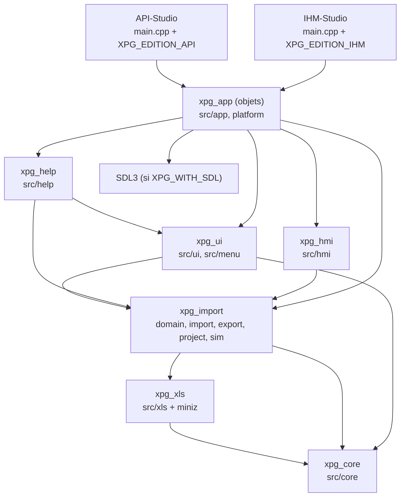
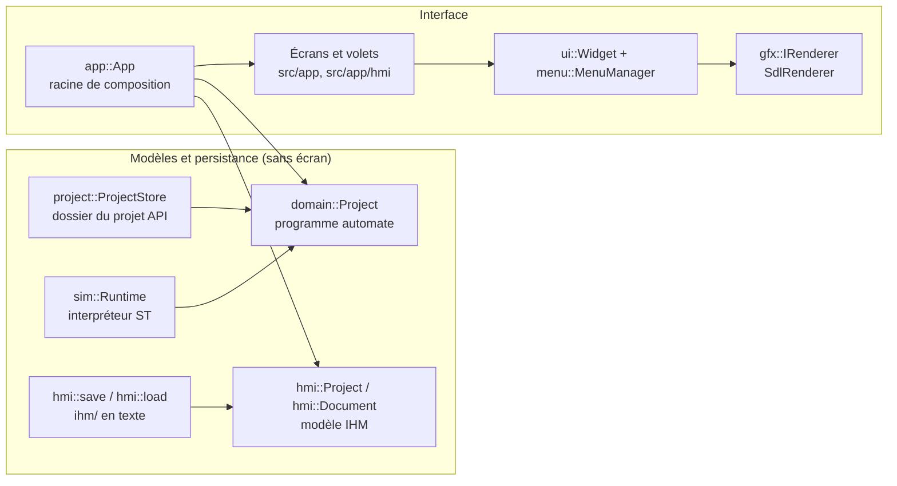
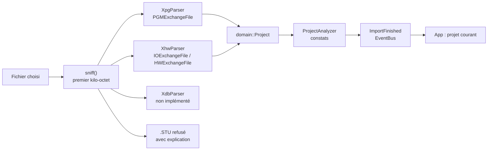
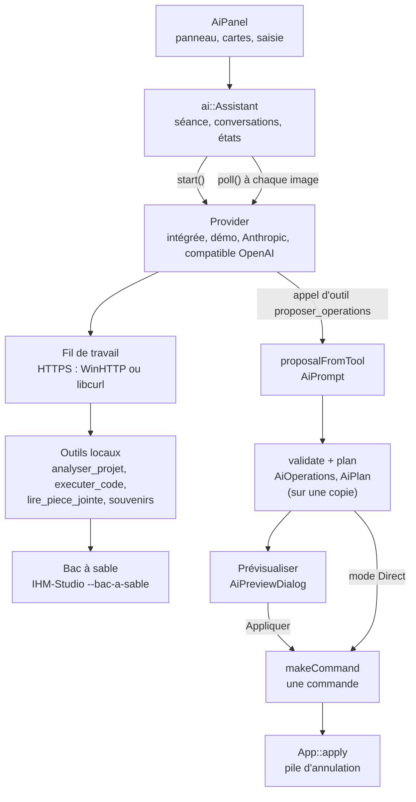

# Architecture technique

Ce document décrit l'architecture du code tel qu'il est dans le dépôt (version 1.34.0). Chaque affirmation renvoie à un fichier ou à une cible de compilation que l'on peut ouvrir. Le point d'entrée général de la documentation est le [README](../README.md).

> Ce document remplace la version d'origine, rédigée en anglais au premier jalon du projet (un seul exécutable, quatre essais, un outil d'analyse en lecture seule). Cette version reste consultable dans l'historique Git.

## Sommaire

1. [Un code, deux applications](#un-code)
2. [Bibliothèques de compilation et dépendances](#bibliotheques)
3. [Organisation des sources](#sources)
4. [Modèles, persistance et interface : la séparation](#separation)
5. [Interface : plate-forme, widgets, écrans](#interface)
6. [La boucle d'image](#boucle)
7. [Commandes, annulation et historique](#commandes)
8. [Communication entre modules](#communication)
9. [Fils d'exécution](#fils)
10. [Persistance](#persistance)
11. [Gestion des erreurs, plantages et reprise](#erreurs)
12. [Chaîne d'import d'un export Control Expert](#import)
13. [Architecture de l'Assistant IA](#assistant)
14. [Système de tests](#tests)

---

## 1. Un code, deux applications

Depuis la 1.12.0, la suite produit **deux exécutables indépendants** à partir des mêmes sources :

| Exécutable | Cible CMake | Définition de compilation | Édition (`core::Edition`) |
|---|---|---|---|
| `API-Studio` (`API-Studio.exe`) | `xpg_api` | `XPG_EDITION_API=1` | `Edition::Api` |
| `IHM-Studio` (`IHM-Studio.exe`) | `xpg_ihm` | `XPG_EDITION_IHM=1` | `Edition::Ihm` |

- Seul `src/main.cpp` est compilé deux fois (`xpg_add_edition` dans `CMakeLists.txt`). Il fixe l'édition au lancement par `core::setEdition` avant toute autre initialisation (réglages, instance unique, dossiers).
- Le reste du code interroge l'édition par `core::hasApi()` et `core::hasIhm()` (`src/core/Edition.hpp`) pour n'afficher que sa partie : menus, arbre du projet, aide, dossiers de projets (`projets\api`, `projets\ihm`), clé de l'instance unique. Exemple : l'Assistant IA n'est ajouté à l'écran du projet que si `core::hasIhm()` est vrai (`src/app/screens/MainAnalysisScreen.cpp`).
- `Edition::Both` n'est utilisée que par les essais.
- Le nom affiché vient de `core::productName()` (« API Studio », « IHM Studio ») ; le nom de l'ensemble, `XPG_ANALYZER_NAME`, vaut « API IHM Studio » (`src/core/Version.hpp`). Les dossiers techniques gardent leur nom d'origine (`%APPDATA%\XpgAnalyzer`, `XPGAnalyser.ini`, `Documents\XPGAnalyser`) pour ne pas perdre les réglages et les données existants.

Langage : **C++20** (`CMAKE_CXX_STANDARD 20` dans `CMakeLists.txt`, `stdcpp20` dans `XpgAnalyzer.vcxproj`). `src/core/Result.hpp` utilise `std::expected` quand la bibliothèque standard le fournit (`__cpp_lib_expected`) et sinon une implémentation compatible.

---

## 2. Bibliothèques de compilation et dépendances

Les sources sont ramassées par dossier (`xpg_sources()` avec `file(GLOB_RECURSE ... CONFIGURE_DEPENDS)`), sans liste manuelle. Les liens ci-dessous sont ceux déclarés par `target_link_libraries` dans `CMakeLists.txt`.

| Cible | Type | Dossiers | Dépend de |
|---|---|---|---|
| `xpg_core` | statique | `src/core` | `Threads::Threads` |
| `xpg_xls` | statique | `src/xls` (+ `third_party/miniz.c` s'il est présent) | `xpg_core` |
| `xpg_import` | statique | `src/domain`, `src/import`, `src/export`, `src/project`, `src/sim` | `xpg_core`, `xpg_xls` |
| `xpg_ui` | statique | `src/ui`, `src/menu` | `xpg_core`, `xpg_import` (Windows : `shell32`, `ole32`) |
| `xpg_help` | statique | `src/help` | `xpg_import`, `xpg_ui` |
| `xpg_hmi` | statique | `src/hmi` | `xpg_import` (Windows : `ws2_32`, `advapi32`, `iphlpapi`, `shell32`, Media Foundation ; Linux : `dl`) |
| `xpg_app` | objets | `src/app` (dont `app/ai`, `app/hmi`, `app/screens`, `app/tutorial`), `src/platform/FontAtlas.cpp`, `src/platform/Sdl*.cpp` si SDL | `xpg_ui`, `xpg_import`, `xpg_help`, `xpg_hmi`, `SDL3::SDL3` (si `XPG_WITH_SDL`), Windows : `winhttp`, `crypt32` ; Linux : `dl` |
| `xpg_api`, `xpg_ihm` | exécutables | `src/main.cpp` | `xpg_app` |
| `xpg_analyzer` | cible personnalisée | — | construit `xpg_api` et `xpg_ihm` |

Options CMake (`CMakeLists.txt`) :

| Option | Défaut | Effet |
|---|---|---|
| `XPG_WITH_SDL` | `ON` | Construit l'interface graphique (SDL3 exigé par `find_package(SDL3 CONFIG REQUIRED)`). À `OFF`, les exécutables se construisent mais n'ouvrent pas de fenêtre : seul `--cli` fonctionne (`App::initPlatform`). |
| `XPG_BUILD_TESTS` | `ON` | Construit et enregistre les essais. |
| `XPG_WARNINGS_AS_ERRORS` | `OFF` | `-Werror` / `/WX`. |
| `XPG_SANS_NPCAP` | `OFF` | Retire la capture réseau de l'espion Modbus (Npcap / libpcap). |

---

## 3. Organisation des sources

| Dossier | Fichiers `.cpp/.hpp` | Rôle | Dépend de l'écran ? |
|---|---:|---|---|
| `src/core` | 23 | `Result`/`Status`/`ErrorCode`, `Signal`, `EventBus`, commandes et pile d'annulation (`Command.hpp`), écriture atomique (`AtomicFile`), rapport de plantage (`CrashGuard`), historique interne (`CallTrail`), instance unique (`SingleInstance`), processus enfant borné (`Process`), édition et version | non |
| `src/xls` | 7 | Lecture des classeurs `.xlsx`/`.xlsm` (`Workbook`, `XlsmSource`, `MacroXls`) | non |
| `src/domain` | 6 | Modèle du programme automate : `domain::Project` (variables, types dérivés, POU, sections, tâches), ordre d'exécution | non |
| `src/import` | 9 | Lecteur XML en flux (`XmlReader`), lecteurs `.XPG` et `.XHW`, analyse (`ProjectAnalyzer`), orchestration (`ProjectImporter`) | non |
| `src/export` | 11 | Réécriture `.XPG` (`XpgWriter`), programme lisible en texte, Excel, PDF et HTML (`ProgramBook*`) | non |
| `src/project` | 83 | Projet API sur disque (`ProjectStore`), états et verrou (`Security`), archives (`ProjectArchive`, `ApiArchive`), commandes d'édition, renommage, suppression, GRAFCET, macros, bibliothèque partagée, contrôles, statistiques | non |
| `src/sim` | 17 | Interpréteur ST (`Interpreter`, `Runtime`), valeurs, JSON des scripts | non |
| `src/ui` | 71 | Cadre d'interface maison : `Widget`, `WidgetHost`, mises en page, widgets (`ui/widgets`), thèmes, icônes, zoom, coloration syntaxique | oui, via `gfx::IRenderer` |
| `src/menu` | 4 | Pile d'écrans (`MenuManager`, `IMenu`, `WidgetMenu`) | oui |
| `src/help` | 47 | Centre d'aide, aide F1, raccourcis, notes de version, didacticiels, signalement de problème | non (rend des données) |
| `src/hmi` | 288 | Modèle IHM (`HmiModel.hpp`), fichiers (`HmiStore`, `HmiArchive`), commandes (`HmiCommands`), vérifications (`HmiCheck`), génération incrémentale (`HmiPipeline`), moteur d'exécution (`HmiRuntime*`), communication (Modbus TCP, serveur web, notifications), incidents, enregistrements | non (« le modèle ne sait rien de l'écran », en tête de `HmiModel.hpp`) |
| `src/platform` | 11 | `gfx::IRenderer`, `SdlRenderer`, `SdlEventPump`, `FontAtlas` (stb_truetype), événements d'entrée | c'est l'écran |
| `src/app` | 174 (+ sous-dossiers) | Racine de composition (`App`), écrans, volets, dialogues, réglages, dossiers, reprise, exports | oui |
| `src/app/ai` | 98 | Assistant IA | partiellement (`AiPanel`, dialogues) |
| `src/app/hmi` | 208 | Éditeur de vues et volets de l'IHM (`HmiEditor`, `HmiCanvas`, peintres) | oui |
| `src/app/screens` | 48 | Écrans et espaces de travail (`MainAnalysisScreen`, `StartScreen`, `StationScreen`, …) | oui |
| `src/app/tutorial` | 9 | Exécution des didacticiels | oui |

Les fichiers C++ sont en ASCII ; les textes accentués de l'interface sont écrits en octets UTF-8 échappés (`"\xC3\xA9"`).

---

## 4. Modèles, persistance et interface : la séparation

- **Programme automate** (API Studio) : `domain::Project` stocke des vecteurs plats ; les relations sont des indices 32 bits, les noms sont internés dans un `StringPool` (stockage `std::deque` pour que les vues de chaînes restent valides). `project::ProjectStore` le lit et l'écrit dans le dossier du projet.
- **Modèle IHM** (IHM Studio) : une seule structure `hmi::Object` pour les 116 genres d'objets (`kKindInfos`, `HmiModel.hpp`), avec un sac de propriétés texte (`Prop {key, value, expr}`). `hmi::Document` ajoute le signal `changed` et l'état « modifié ».
- **Interface** : `app::App` possède le projet, la pile de commandes, la pile d'écrans, la simulation et les liaisons. Les écrans lisent les modèles et envoient des commandes ; ils ne modifient pas le modèle directement.
- Les bibliothèques sans écran (`xpg_core`, `xpg_import`, `xpg_hmi`, `xpg_help`) sont essayées sans serveur graphique (voir [TESTS.md](TESTS.md)).

---

## 5. Interface : plate-forme, widgets, écrans

### Plate-forme et rendu

- **SDL3** est la seule bibliothèque de fenêtrage et de rendu (fenêtre, événements, presse-papiers, son ; `third_party/SDL3/ORIGINE.txt`). SDL3_ttf, SDL3_image et SDL3_mixer ne sont pas utilisés.
- `gfx::IRenderer` (`src/platform/Renderer.hpp`) est l'interface de dessin : rectangles (pleins, arrondis, contours), lignes, triangles, texte, images RGBA, découpe, dessin hors écran.
- Implémentations présentes dans le code :
  - `SdlRenderer` (`src/platform/SdlRenderer.cpp`) : `SDL_Renderer` de SDL3, créé par `SDL_CreateRenderer(window, nullptr)` ; le pilote de rendu effectif (Direct3D, OpenGL, logiciel…) est donc choisi par SDL, le code n'en impose aucun ;
  - `SvgRenderer` (`src/app/SvgRenderer.hpp`) : écrit du SVG (exports, outils de prévisualisation de `tools/`) ;
  - `ZoomRenderer` (`src/ui/Zoom.hpp`) : applique le zoom d'un widget.
- Texte : `gfx::FontAtlas` rasterise une police TrueType avec `stb_truetype` dans de la mémoire, sans SDL. Polices cherchées dans `resources/fonts/` (absent du dépôt), puis dans les polices du système (Segoe UI, Tahoma, Consolas sous Windows ; DejaVu, Liberation sous Linux) — `src/platform/FontAtlas.cpp`.
- Images et sons : `stb_image`, `stb_image_write`, `nanosvg`, `minimp3` (`third_party/`). PDF : PDFium chargé à la demande (`src/hmi/HmiPdf.cpp`). Vidéo : Motion-JPEG en AVI décodé partout ; MP4/H.264, WMV et MOV via Media Foundation sous Windows, chargé à la demande (`CMakeLists.txt`, `src/hmi/HmiVideoMf.cpp`).

### Widgets

- `ui::Widget` (`src/ui/Widget.hpp`) : arbre de widgets (le parent possède ses enfants par `unique_ptr`), identifiant (`findById`), visibilité, focus, infobulles, zoom (`ZoomSupport::Scaled` ou `Native`). Mise en page (`layout`), dessin (`render` → `onPaint`, puis `onPaintOverlay`), événements (`dispatch` : capture → cible → remontée).
- Mises en page : `src/ui/Layout.hpp`. Widgets : `src/ui/widgets/` (contrôles, conteneurs, vues de données virtualisées `ListView`/`TreeView`/`TableView`, `PropertyGrid`, éditeur de code, barres de défilement, explorateur de fichiers…).
- `ui::WidgetHost` porte un arbre hors de la pile d'écrans (fenêtres détachées).
- Thèmes intégrés et thèmes de l'utilisateur (`.xpgtheme`, `src/ui/ThemeFile.cpp`).

### Écrans

- `menu::MenuManager` (`src/menu/MenuManager.hpp`) gère une pile de couches de genres `Screen`, `Modal`, `Dialog`, `Overlay`. Les demandes de navigation sont mises en file et appliquées au début de l'image suivante (`applyPending`), pour qu'un écran ne soit jamais détruit pendant qu'il traite son propre événement.
- Écrans enregistrés par `App::buildMenuFactory` (`src/app/App.cpp`) : `startup` (accueil), `analysis` (écran du projet, `MainAnalysisScreen`), `station` (poste d'exploitation), centre d'aide, etc.
- Les fenêtres modales sont des `menu::WidgetMenu` de genre `Dialog`, déplaçables et redimensionnables (`src/ui/DialogFrame.hpp`).

---

## 6. La boucle d'image

`App::run` (`src/app/App.cpp`) enchaîne à chaque image `pumpEvents` puis `App::frame` :

1. lecture des événements SDL, traduits en `ui::InputEvent` (`src/platform/SdlEventPump.cpp`) et transmis à `MenuManager::HandleEvent` ;
2. `bus_.drain()` : livraison des notifications différées de l'`EventBus` sur le fil de l'interface ;
3. `menus_->applyPending()` : navigation mise en file ;
4. avancement des services possédés par l'application : simulation de l'automate (`SimulationHost::tick`), liaisons de communication, équipements, sauvegarde de reprise (`Recovery::tick`)… ;
5. `menus_->Update(...)` : logique et animations des écrans ; c'est là que les écrans lisent l'état des tâches de fond (voir § 9) ;
6. `beginFrame`, `menus_->Render(...)`, couche des didacticiels, fin d'image.

La simulation appartient à l'application (`src/app/SimulationHost.hpp`) et non à un écran : elle continue quand on change d'écran.

---

## 7. Commandes, annulation et historique

- `core::ICommand`, `core::CommandStack`, `core::GroupCommand`, `core::CommandGroupScope` (`src/core/Command.hpp`). Toute modification de l'utilisateur passe par `App::apply(commande)` et devient un pas d'annulation (Ctrl+Z / Ctrl+Y).
- Une rafale de frappe ne fait qu'un pas tant qu'on ne s'arrête pas plus de 2,5 s (`setMergeWindow`, `App::create`).
- Côté IHM, les commandes sont des instantanés : `hmi::changeView` et `hmi::changeProject` gardent l'état avant/après des seuls objets touchés (`src/hmi/HmiCommands.hpp`). Une fonction qui ne change rien ne produit aucune commande.
- `core::ActionRegistry` associe un identifiant texte (`project.save`, `ia.assistant`…) à chaque action ; les raccourcis viennent d'une seule table, `src/help/Shortcuts.cpp`.
- L'historique de la séance (Ctrl+H) montre chaque pas avec son endroit. Il est distinct de l'historique des modifications des objets IHM, écrit à l'enregistrement (`src/hmi/HmiEditHistory.hpp`).

---

## 8. Communication entre modules

| Mécanisme | Fichier | Usage |
|---|---|---|
| `core::EventBus` | `src/core/EventBus.hpp` | Publication/abonnement typés, différés et protégés par un verrou ; livrés sur le fil de l'interface par `drain()`. Exemple : `importer::ImportFinished` → `App` remplace le projet → `ProjectOpened`. |
| `core::Signal` | `src/core/Signal.hpp` | Observateur direct avec connexion RAII (un widget ne peut pas être rappelé après sa destruction). |
| Hôtes par fonctions | ex. `app::ai::Assistant::Host` (`src/app/ai/AiAssistant.hpp`) | Un module sans écran reçoit des fonctions (document, vue active, `apply`) au lieu de pointeurs vers l'interface. |
| Services de plate-forme | `ui::installPlatformServices` (`App::initPlatform`) | Presse-papiers, glisser-déposer, fichiers. |

---

## 9. Fils d'exécution

**Règle** : un seul fil pour l'interface et les modèles. Les fils de travail écrivent dans un état partagé protégé ; l'écran le lit à chaque image (interrogation, « poll »). Le modèle n'est modifié que sur le fil de l'interface.

Fils de travail présents dans le code (recherche de `std::thread`/`std::async`) :

| Domaine | Fichiers |
|---|---|
| Import d'un export | `src/import/ProjectImporter.cpp`, `src/app/ImportJob.*` |
| Génération incrémentale de l'IHM | `src/app/hmi/HmiBuild.*` |
| Communication : Modbus TCP, lecture cyclique, outil Modbus, espion, scanner IP | `src/hmi/HmiModbus*.cpp`, `HmiComm.*`, `HmiSpy.*`, `HmiIpScan.*` |
| Serveur web intégré, notifications (courriel, SMS) | `src/hmi/HmiWeb.*`, `src/hmi/HmiNotify.*` |
| Recherche de fichiers sur le PC, aperçus | `src/app/FileFinder.*`, `src/app/FileViewer.cpp` |
| Incidents (écriture des dossiers) | `src/app/hmi/HmiIncidentHost.*` |
| Assistant IA : fournisseurs, pièces jointes, application en fond, notifications | `src/app/ai/AiAnthropic.*`, `AiOpenAI.*`, `AiAssistant.*`, `AiAttachments.hpp`, `AiNotifications.cpp` |
| Chien de garde et rapport de plantage, instance unique, processus enfants | `src/core/CrashGuard.cpp`, `SingleInstance.cpp`, `Process.cpp` |

Les tâches de fond visibles par l'utilisateur sont listées dans la barre du haut (`src/app/BackgroundTasks.hpp`).

---

## 10. Persistance

| Donnée | Format | Code |
|---|---|---|
| Projet API | dossier : `project.xpgproj`, `vars/`, `ddt/`, `dfb/`, `units/`, `sections/*.st`, `config/`, `src/` (généré) | `src/project/ProjectStore.hpp` |
| Projet IHM | `ihm/ihm.txt` et un fichier par vue (`ihm/vues/*.vue`), texte ligne à ligne terminé par `fin`, écrit à côté puis renommé ; format 33 au plus | `src/hmi/HmiStore.hpp` |
| Archives `.xapi`, `.xihm` | zip avec `manifeste.txt` (comptes, SHA-256 de chaque fichier) | `src/project/ProjectArchive.hpp`, `ApiArchive.hpp`, `src/hmi/HmiArchive.hpp` |
| Versions du projet | `versions/` adressé par contenu (SHA-256) | `src/hmi/HmiVersions.hpp` |
| Réglages | fichier `clé = valeur` (`settings.txt`) | `src/app/Settings.cpp` |
| Dossiers de l'application | `.ini` (`installation.ini`, `XPGAnalyser.ini`) | `src/app/Dossiers.hpp` |
| Données de l'Assistant IA | JSON (`IA/…`), ordre et champs inconnus conservés | `src/app/ai/AiPaths.hpp`, `AiStore.hpp`, `AiJson` |

Écriture sûre : `core::writeFileAtomic` (`src/core/AtomicFile.hpp`) écrit dans un fichier voisin puis renomme. Le détail des formats est dans [FORMATS.md](FORMATS.md).

---

## 11. Gestion des erreurs, plantages et reprise

- **Erreurs attendues** : `core::Result<T>` / `core::Status` avec `core::ErrorCode` et un message (`src/core/Result.hpp`, macro `XPG_TRY`). Les lecteurs de fichiers ne lèvent pas d'exception et renvoient un diagnostic localisé (numéro de ligne).
- **Diagnostics métier** : constats d'analyse (`importer::Finding`, `src/import/ProjectAnalyzer.hpp`), constats de Générer/Compiler de l'IHM (`hmi::Issue`, `src/hmi/HmiCheck.hpp`), chacun avec l'endroit concerné.
- **Plantage et blocage** : `core::crash::install` pose les gestionnaires (Windows : filtre d'exception, `terminate`, `SIGABRT`… ; Linux : signaux) et écrit `crashs/plantage-<date>.txt` (version, pile, historique interne `CallTrail`) dans le dossier des réglages ; un chien de garde détecte une boucle principale bloquée (`core::crash::startWatchdog(8, …)` dans `main.cpp`). « Signaler le problème » prépare un zip local ; rien n'est envoyé par le réseau (`main.cpp`, `src/help/ProblemReport.*`).
- **Reprise après arrêt brutal** : un verrou de session dans `<réglages>/reprise`, une sauvegarde des modifications non enregistrées toutes les 2 minutes en conception (réglable par `recovery.autosaveSeconds`), l'état du poste d'exploitation toutes les 10 s (`src/app/Recovery.hpp`).
- **Instance unique** : une instance par application et par session ; un second lancement transmet ses arguments à l'instance ouverte (`src/core/SingleInstance.hpp`). `XPG_INSTANCES_MULTIPLES=1` lève la règle.

---

## 12. Chaîne d'import d'un export Control Expert

- `ProjectImporter` (`src/import/ProjectImporter.cpp`) choisit le lecteur d'après le contenu (et non l'extension), fusionne plusieurs fichiers dans un même `domain::Project`, travaille hors du fil de l'interface et ne publie le projet qu'une fois l'analyse terminée.
- Lecteurs enregistrés : `XpgParser`, `XdbParser`, `XhwParser`. `XdbParser` renvoie `NotImplemented`. Les fichiers `.XEF`/`.ZEF` sont reconnus par `sniff()` mais aucun lecteur enregistré ne les accepte dans ce commit : leur import échoue (« no parser recognises this file »).
- `XmlReader` est un lecteur XML en flux, sans arbre DOM ni exception.
- Les sections LD, FBD et SFC sont conservées telles que Control Expert les a écrites et réexportées à l'identique ; elles sont rendues lisibles en texte (`src/project/GraphListing.hpp`) mais ne sont ni modifiables ni simulées.
- `ProjectAnalyzer` produit les constats : variables globales ou locales inutilisées, types dérivés et DFB inutilisés, sections non référencées, vides, sans condition, trop longues, adresses en double, types non définis, E/S situées non documentées (`FindingKind`).

---

## 13. Architecture de l'Assistant IA

L'Assistant IA vit dans `src/app/ai` et n'est construit que dans IHM Studio. Principe : **le fournisseur ne touche jamais au modèle** ; toute modification est une proposition validée, prévisualisée sur une copie puis appliquée en une seule commande.

- `Provider::start()` part sur un fil de travail ; `poll()` est appelé à chaque image sur le fil de l'interface et rend les événements reçus (texte, appel d'outil, fin) ; `cancel()` ferme la connexion (`src/app/ai/AiProvider.hpp`).
- L'IA intégrée et la démonstration calculent leur réponse sur le fil de l'interface, sans réseau, puis la « déroulent » au rythme de `tick()` (`AiAssistant.hpp`).
- Une proposition d'au moins 40 opérations est vérifiée et appliquée sur une copie du projet dans un fil de fond ; le résultat n'est posé (une seule commande) que si le projet n'a pas changé entre-temps (`Assistant::applyInBackground`, `kBackgroundOps = 40`).
- **Missions IA (1.22.0)** : `AiMission` (le modèle et ses règles, sans disque ni réseau : états des étapes, plan, ordre, lots, suivi des propositions, progression, rapport) et `AiMissionStore` (fichiers `IA/missions/<id>.json` écrits d'un bloc avec une copie `.bak`, empreinte du projet, reprise) ; `ai::Assistant` les tient à jour à chaque événement ; `AiMissionsView`, `AiMissionStrip` et `AiMissionBoard` les montrent (onglet, bande, tableau de bord au centre). Le projet réel reste la source de vérité : une étape n'est terminée que si ce qu'elle a créé est dans le projet.
- Le détail (fournisseurs, données envoyées, stockage, limites) est dans [ASSISTANT-IA.md](ASSISTANT-IA.md).

---

## 14. Système de tests

- Les essais sont des exécutables autonomes déclarés dans `CMakeLists.txt` et lancés par CTest. Chacun définit sa propre fonction de vérification (pas de cadriciel externe).
- Ils ne demandent pas d'écran : ils lient les bibliothèques sans SDL, ou des sources de `src/app` nommées explicitement (ou `xpg_app` construit sans SDL).
- Les réseaux et les fournisseurs d'IA sont remplacés par des faux injectables (`setHttpFactory`, `tests/fixtures/ia/faux_fournisseur.py`).
- Le projet Visual Studio est contrôlé par l'essai `vcxproj` (`outils/verifier_vcxproj.py`).

Voir [TESTS.md](TESTS.md).
