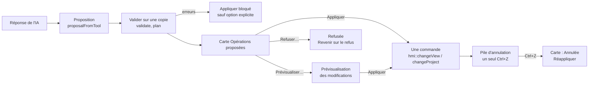

# Assistant IA

Référence de l'Assistant IA d'**IHM Studio** (version 1.22.2), établie à partir du code de `src/app/ai/`. Le guide d'utilisation détaillé, avec les libellés de chaque écran, est l'aide F1 (sujets « L'Assistant IA », « Le plan d'action… », « L'IA intégrée », « Mémoire et apprentissage de l'IA » dans `tools/guide-ihm/guide-ihm.txt`). Retour au [README](../README.md).

## Sommaire

1. [Disponibilité et principe](#principe)
2. [Fournisseurs](#fournisseurs)
3. [Ce qui reste sur le PC, ce qui part chez un fournisseur](#confidentialite)
4. [Clés API](#cles)
5. [Conversations](#conversations)
6. [Propositions d'opérations](#operations)
7. [Validation, prévisualisation, application, annulation](#application)
8. [Plan d'opérations et compte rendu](#plan)
9. [Grandes demandes : propositions successives et « Proposer la suite »](#suite)
9 bis. [Missions IA persistantes (1.22.0)](#missions)
10. [Pièces jointes](#pieces)
11. [Outils exécutés sur le PC à la demande de l'IA](#outils)
12. [Apprentissage local, mémoire et souvenirs](#memoire)
13. [Notifications de l'Assistant](#notifications)
14. [Consommation, limite et budget](#consommation)
15. [Incidents](#incidents)
16. [Données sur le disque](#donnees)
17. [Limites connues](#limites)
18. [Carte du code](#code)

---

<a id="principe"></a>
## 1. Disponibilité et principe

- **IHM Studio uniquement** : le panneau est ajouté à l'écran du projet seulement si `core::hasIhm()` est vrai (`src/app/screens/MainAnalysisScreen.cpp`). API Studio n'a pas d'Assistant IA.
- Ouverture : **Ctrl+Maj+I**, menu **Affichage › Assistant IA** (ou la case du panneau dans Affichage › Panneaux), **Projet › Disposition…**, ou **Ctrl+K** (« Assistant IA »). Le panneau est le quatrième volet de l'écran du projet, à droite de l'éditeur de vues, replié au départ.
- L'utilisateur décrit en français ce qu'il veut. L'Assistant répond par du texte et, s'il y a lieu, par une **proposition** : une liste d'opérations sur les vrais objets du modèle IHM.
- **Rien ne modifie le projet sans passer par** la validation, l'aperçu (mode Prévisualisation) et une commande unique de la pile d'annulation. Un fournisseur ne touche jamais au modèle (`src/app/ai/AiProvider.hpp`).
- L'Assistant **n'invente ni variable, ni propriété, ni genre d'objet** : une variable citée qui n'existe pas est une erreur bloquante, et l'utilisateur choisit une variable existante ou sa création (`src/app/ai/AiOperations.hpp`).

---

<a id="fournisseurs"></a>
## 2. Fournisseurs

Réglage « Fournisseur » des **Paramètres de l'Assistant IA** (`Settings::provider`, `src/app/ai/AiStore.hpp`).

| Clé | Libellé | Réseau | Ce que c'est |
|---|---|---|---|
| `integree` | IA intégrée (sans connexion) | non | Une IA à règles écrite dans le logiciel (`AiLocal`, `AiDesign`) : verbes, genres et leurs synonymes, nombres, couleurs, positions, noms du projet. Choix par défaut d'une installation neuve. Elle ne devine pas : une demande non comprise reçoit une réponse honnête et des formulations comprises. |
| `demo` | Démonstration (sans IA) | non | Six demandes reconnues par mots-clés (`AiDemo`). Gardée pour un fichier de paramètres existant qui ne précise pas de fournisseur. |
| `anthropic` | Anthropic (Claude) | oui | API Messages d'Anthropic (`https://api.anthropic.com`), ou un **relais d'entreprise** donné dans « Adresse ». |
| `openai` | Compatible OpenAI | oui | Tout service exposant `<adresse>/chat/completions`. Services préréglés (`src/app/ai/AiOpenAI.cpp`) : Ollama (`http://localhost:11434/v1`), LM Studio (`http://localhost:1234/v1`), OpenRouter, Groq, Google Gemini, Mistral, ou « Autre ». |

Autres réglages notables : **Modèle** (case libre, vide par défaut : aucun modèle imposé par le logiciel ; « Lister les modèles » interroge le service), **Effort** (Auto, Bas, Moyen, Haut), **Délai** d'inactivité (60 s par défaut), **Fenêtre de contexte** (Auto ou un nombre de jetons ; sous 16 000, les consignes envoyées sont resserrées), **Réponse** (longueur maximale d'une réponse, Auto = 64 000 jetons, voir § 9), **Outil** (appel d'outil, JSON dans le texte, ou Auto), **Budget**, mode par défaut (**Prévisualisation** ou **Direct**), conservation des conversations, confidentialité.

**IA intégrée d'abord** (`localFirst`, décochée par défaut) : avec Anthropic ou un service compatible, chaque demande passe d'abord par l'IA intégrée ; ce qu'elle comprend est répondu sans connexion, le reste part à l'IA connectée avec la conversation.

Transport HTTPS (`src/app/ai/AiHttp.hpp`) : **WinHTTP** sous Windows (le TLS, les proxys et les certificats du système), **libcurl** chargée à la demande (`dlopen` de `libcurl.so.4`) sous Linux ; absente, l'Assistant le dit. `http://` n'est accepté que vers ce poste (`localhost`, `127.x`, `::1`), et, pour un service compatible OpenAI **sans clé**, vers une adresse IPv4 privée (10.x, 192.168.x, 172.16 à 172.31.x).

---

<a id="confidentialite"></a>
## 3. Ce qui reste sur le PC, ce qui part chez un fournisseur

| Traitement | Où il se fait |
|---|---|
| IA intégrée, démonstration | Entièrement sur le PC, sans réseau. |
| Validation, plan, aperçu, application, annulation | Sur le PC, toujours (y compris avec une IA en ligne). |
| Lecture des pièces jointes (extraction du texte d'un PDF, d'un DOCX, d'un classeur ; découpage) | Sur le PC, dans un fil de travail. |
| Outils locaux appelés par l'IA (analyse du projet, bac à sable, lecture exacte de lignes, souvenirs) | Sur le PC ; seul leur **résultat** est renvoyé au fournisseur connecté. |
| Mémoire, connaissances, souvenirs, modèles de fichiers, apprentissage | Stockés sur le PC (`IA/`), jamais dans le projet. |
| Avec **Anthropic** ou un **service compatible OpenAI** | Partent chez le fournisseur, à chaque demande : la demande, **la conversation entière** (demandes, réponses, sort des propositions), les consignes et le registre des genres d'objets, le texte des connaissances actives, et selon les cases de confidentialité (`sendView`, `sendSelection`, `sendVariables`, `sendAttachments`, toutes cochées par défaut) : la vue active et ses objets, la sélection, les noms et types des variables, les pièces jointes (ou leur texte extrait). |
| Modèle sur ce PC (Ollama, LM Studio) | Les mêmes données, mais envoyées à un service qui tourne sur le PC lui-même. |

Avant le premier envoi d'une conversation à une IA connectée, une ligne sous la saisie indique ce qui va partir. La clé API ne part que dans l'en-tête de la requête ; elle n'est jamais écrite dans un journal ni dans un message (`AiProvider.hpp`, `AiHttp.hpp`).

> L'Assistant **n'entraîne ni ne réentraîne aucun modèle**. L'« apprentissage » est une mémoire locale relue et jointe aux demandes (voir § 12 ; constante `kNotRetrained`, `src/app/ai/AiKnowledge.hpp`).

---

<a id="cles"></a>
## 4. Clés API

- **Gestionnaire des clés** (1.18.0, `src/app/ai/AiKeys.hpp`) : plusieurs clés nommées, une **active** par fournisseur (`anthropic` ou `openai`). Ouvert par « Gérer les clés… » dans les Paramètres.
- Stockage :
  - `IA/cles/index.json` : ce qui n'est pas secret (nom, fournisseur, adresse et modèle préférés, **les 4 derniers caractères** de la clé, dates, dernier essai, clé active) ;
  - `IA/cles/<id>.bin` : la clé **protégée par DPAPI** sous Windows (`CryptProtectData`, liée à la session de l'utilisateur : un autre compte ou un autre PC ne la relit pas) — `src/app/ai/AiSecret.hpp`.
- **Sous Linux**, aucun coffre n'est utilisé : la clé est gardée en mémoire pour la séance seulement.
- Option « pour cette séance seulement » : la clé n'est jamais écrite.
- Le dossier `IA/` est dans les réglages de l'utilisateur : une réinstallation ou une désinstallation n'y touche pas (le journal de l'installateur indique le nombre de clés gardées).
- La clé `IA/cle.bin` des versions 1.15 à 1.17 est reprise au premier lancement (`migrateLegacy`).
- Un **relais d'entreprise** (Adresse) peut détenir la clé côté serveur ; le logiciel n'en a alors aucune.
- « Tester » une clé interroge la liste des modèles du fournisseur, sans consommer de jetons.

---

<a id="conversations"></a>
## 5. Conversations

- Un fichier JSON par conversation : `IA/conversations/<id>.json` (messages, pièces jointes, état et opérations de chaque proposition), écrit de façon atomique (`src/app/ai/AiStore.hpp`). Les champs inconnus sont conservés.
- Créer, ouvrir, renommer (double-clic ou F2), supprimer (confirmation). Conservation réglable en jours et en nombre (0 = sans limite).
- La conversation garde le nom, le chemin et la vue du projet, jamais une copie du projet.
- Chaque tour renvoie à l'IA le **résultat réel** de ses propositions précédentes : appliquée, refusée, en attente, annulée par Ctrl+Z, ou refusée par la validation avec la raison.
- Un index de recherche régénérable est tenu dans `IA/index/conversations.json`.

---

<a id="operations"></a>
## 6. Propositions d'opérations

L'IA connectée propose par l'outil `proposer_operations` (`kOperationsTool`, `AiProvider.hpp`), ou par un JSON dans le texte si le modèle ne gère pas l'appel d'outil. Opérations acceptées (`src/app/ai/AiOperations.hpp`) :

| Famille | Opérations |
|---|---|
| Objets d'une vue | `creer` (un genre de `kKindInfos`, seulement les propriétés que `hmi::makeObject` donne à ce genre), `modifier` (dont déplacer et redimensionner par x, y, w, h), `associer` (une variable **existante**), `aligner`, `distribuer`, `dupliquer` (avec repères `$…$`), `supprimer`, `code` (code brut d'objets, au format des fichiers de vue) |
| Vues et symboles | `creer_vue` (avec rôle : vue, symbole, popup, modèle, en-tête, pied ; paramètres et génériques), `creer_symbole`, `creer_popup`, `creer_modele_vue` |
| Données | `creer_variables`, `creer_type` (structures, génériques), `adresser` (adresse d'une variable liée à un équipement, formules de lien pour un tableau de structures) |
| Équipements | `creer_equipement` (Modbus TCP/IP ou Ethernet TCP/IP) ; `detecter` **propose** une détection, que l'utilisateur lance lui-même |
| Programmation | `creer_script`, `creer_fonction` (ST, C, C++) : compilés par le compilateur du logiciel pour les diagnostics, **jamais exécutés** par l'application |
| Alarmes, ressources, rangement | `creer_alarme` (condition compilée), `creer_ressource` (depuis une pièce jointe), `creer_dossier`, `ranger` |
| Suppression intelligente (1.21.0) | `supprimer` + genre : vue, popup, symbole, instance, écran modèle, variable, type, alarme, script, fonction, équipement, ressource, dossier — avec le graphe des relations, une stratégie (seul, remplacer par un élément existant, références, + inutiles), des exclusions et une confirmation (`src/app/ai/AiDelete.hpp`) |

Refusé à la lecture : toute opération inconnue ; dans une opération `code`, une action qui porte du code (exécuter un script, appeler, calcul) ou une fonction redéfinie. Une valeur commençant par `=` est une formule, vérifiée comme dans l'inspecteur.

Les suppressions côté automate (API Studio) ne sont pas à la portée de l'Assistant dans cette version (`AiDelete.hpp`).

---

<a id="application"></a>
## 7. Validation, prévisualisation, application, annulation



- **Valider** ne touche à rien : comptes (à créer, à modifier, à supprimer), propriétés avant → après, variables associées, avertissements, erreurs. Les opérations sont jouées **sur une copie** ; les scripts, fonctions et alarmes créés y sont **compilés** (jamais exécutés) par le compilateur du logiciel, et une erreur de compilation est une erreur de la proposition (`AiOperations.cpp`).
- **Prévisualiser…** ouvre la fenêtre « Prévisualisation des modifications » : liste des changements, et la vue modifiée dessinée par les peintres de l'éditeur (objets nouveaux encadrés en vert, modifiés en bleu, à supprimer barrés de rouge), zoomable. Échap ferme **sans décider**.
- **Appliquer** : toutes les opérations dans **une seule commande** (`makeCommand`) ; l'historique la montre sous « Assistant IA : … ». Un **Ctrl+Z** reprend tout ; la carte passe à « Annulée » et propose **Réappliquer**.
- **Grosse proposition** (≥ 40 opérations) : vérification et application sur une copie du projet dans un fil de fond, avec barre d'avancement ; le résultat n'est posé, en une commande, que si le projet n'a pas changé entre-temps (`Assistant::applyInBackground`).
- **Mode Direct** : la proposition s'applique dès la fin de la réponse, sans aperçu ; toujours une seule commande. Une suppression de plusieurs objets demande toujours confirmation.
- **Appliquer malgré les erreurs** (option décochée par défaut) : après confirmation, ce qui est valide s'applique et ce qui est en erreur est laissé de côté et noté.
- **Refuser…** demande confirmation ; « Revenir sur le refus » rend la proposition de nouveau applicable.
- **Empreinte** : une proposition garde l'empreinte de la vue ; si la vue a changé ou n'existe plus, la proposition ne s'applique jamais (« Périmée », bouton **Redemander**).

---

<a id="plan"></a>
## 8. Plan d'opérations et compte rendu

`src/app/ai/AiPlan.hpp` (1.19.0) rend une grande proposition lisible et sûre :

- **étapes** : une par opération, avec sa catégorie (types et variables, équipements, adresses, scripts et fonctions, alarmes, vues et symboles, popups, ressources, dossiers) ;
- **dépendances** calculées sur les noms réellement écrits (une alarme et sa variable, un symbole et son type…) ;
- **ordre** : tri topologique des unités par dépendances, jamais l'ordre d'écriture de l'IA ; un cycle est une erreur bloquante (sauf entre du code) ;
- **états** : à faire, validée, appliquée, échouée, ignorée, annulée — mis à jour par l'exécution réelle ;
- **compte rendu** après Appliquer, **lu dans le projet** (avant / après), jamais recopié de ce que l'IA avait annoncé.

Une bande « Plan en cours » au-dessus de la discussion montre le plan de la proposition qui se vérifie ou s'applique (1.20.2).

---

<a id="suite"></a>
## 9. Grandes demandes : propositions successives et « Proposer la suite »

Depuis la 1.21.3 (`docs/LIVRAISON-1.21.3.md`, `src/app/ai/AiPanel.cpp`) :

- **Longueur d'une réponse** : réglage « Réponse », Auto = 64 000 jetons (`kAutoOutputTokens`), au plus la moitié de la fenêtre de contexte connue. Si le service refuse cette longueur, la demande repart aussitôt avec la valeur qu'il annonce, retenue pour la séance ; aucune limite n'est codée par modèle.
- **L'IA connaît sa limite** : chaque demande lui indique sa longueur et environ combien d'opérations elle peut écrire. Une demande plus grande est découpée en plusieurs propositions : la première est complète et applicable seule, le reste est décrit dans un champ « suite ».
- La carte affiche **« Suite prévue : … »** ; une fois la proposition appliquée, le bouton **Proposer la suite** envoie « Propose la suite : … », et la partie suivante arrive sur une nouvelle carte, à vérifier et appliquer comme la première. La suite est conservée avec la conversation.
- **Reprise automatique** : si une proposition dépasse malgré tout la longueur pendant qu'elle s'écrit, elle est redemandée une fois en plusieurs parties ; une seconde coupure est signalée sans nouvelle tentative. Une proposition coupée n'est **jamais** appliquée, même en partie. Une réponse purement textuelle coupée n'est pas redemandée.

---

<a id="missions"></a>
## 9 bis. Missions IA persistantes (1.22.0)

Une demande trop grande pour une proposition devient une **mission** : un objet de l'application, gardé dans `IA/missions/<id>.json`, indépendant de la conversation qui l'a lancée (`src/app/ai/AiMission.*`, `AiMissionStore.*` ; audit préalable : [AUDIT-MISSIONS-1.22.0.md](AUDIT-MISSIONS-1.22.0.md) ; détail : [LIVRAISON-1.22.0.md](LIVRAISON-1.22.0.md)).

- **Création** : la carte « Créer une mission IA ? » au moment d'envoyer une demande complexe (heuristique `looksComplex`, jamais pour une question), ou le **+** de l'onglet **Missions IA**. Il faut une IA connectée (pas l'IA intégrée ni la démonstration) et un projet ouvert.
- **Plan** : l'IA analyse le projet réel puis appelle l'outil `planifier_mission` (étapes, catégories, dépendances, estimation d'opérations). L'ordre est calculé par le logiciel (tri topologique stable) ; des dépendances **implicites** s'ajoutent par catégorie, sans cycle ; un cycle est refusé. Un plan revu fusionne avec l'existant (rien n'est remis à zéro).
- **États d'une étape** : à planifier, en attente, prête, en cours, en attente de validation, appliquée, vérification, terminée, en erreur, bloquée, ignorée, annulée ; transitions contrôlées (`canMove`).
- **Propositions successives** : les étapes prêtes sont regroupées en un lot à la mesure d'une réponse (`nextBatch`) ; la consigne de chaque proposition contient ce qui est **réellement** dans le projet (les éléments créés par les précédentes, vérifiés) et ce qui a changé ; chaque opération porte son étape (`etape`). Validation, prévisualisation et application inchangées (une commande, un Ctrl+Z).
- **Suivi réel** : après Appliquer, le compte rendu lu dans le projet met les étapes à jour ; une étape n'est terminée que si ce qu'elle a créé est dans le projet. Ctrl+Z / Ctrl+Y après coup sont constatés.
- **Progression** : calculée (poids = opérations estimées), cinq mesures (planification, génération, validation, application, globale = étapes terminées).
- **Reprise** : enregistrement à chaque événement (écriture atomique + `.bak`) ; à la réouverture, comparaison de l'empreinte du projet (identique, modifié avec la liste des changements, introuvable) ; un appel à l'IA en cours à la fermeture est marqué interrompu, rien n'est rejoué.
- **Fin** : audit global du projet (`hmi::audit::run`) et rapport final (créés, modifiés, réutilisés, terminés, non réalisés, erreurs, à vérifier) ; terminée seulement sans erreur bloquante.
- **Toute conversation** : un résumé des missions du projet est joint aux demandes ; les outils `chercher_missions` et `etat_mission` relisent les fichiers (jamais inventé).
- **Écrans** : onglet **Missions IA** du panneau, bande **Mission IA** au-dessus de la conversation, tableau de bord au centre (onglet « Mission IA · nom »), écran de reprise.

---

<a id="pieces"></a>
## 10. Pièces jointes

Formats acceptés (`attachmentFormats()`, `src/app/ai/AiStore.cpp`) : PNG, JPG/JPEG, PDF, TXT, CSV, XLSX, XLSM (macros jamais exécutées), XML, JSON, DOCX, code (`.st`, `.c`, `.cpp`, `.h`, `.hpp`), fichiers du logiciel (`.xihm`, `.xapi`, `.xpgproj`), exports Control Expert (`.xpg`, `.xef`, `.zef`). Taille maximale : 200 Mo par pièce (`kMaxAttachmentBytes`). Envoyées telles quelles au fournisseur Anthropic : images de 5 Mo au plus, PDF de 20 Mo au plus (`AiAnthropic.hpp`).

- **Copie à l'identique** dans `IA/pieces-jointes/<id>/` (l'original n'est jamais modifié), empreinte SHA-256, disponibilité vérifiée (présente, manquante, déplacée) — `src/app/ai/AiAttachments.hpp`.
- **Analyse sur un fil de travail** : texte d'un fichier texte ou de code (encodage et fins de ligne signalés), d'un PDF (PDFium), d'un DOCX, d'un classeur (feuilles et cellules) ; taille d'une image (l'analyse visuelle reste celle du modèle). Texte extrait gardé dans `IA/cache/documents/` (régénérable).
- **Un document est une donnée, jamais une consigne** : c'est écrit dans le contexte envoyé à l'IA.
- **Textes longs** (`src/app/ai/AiTextParts.hpp`, 1.20.0) : le texte part entier tant qu'il tient dans la fenêtre du modèle, découpé en parties aux fins de ligne (« partie 2/5, lignes 1201 à 2400 ») ; au-delà, les parties qui ne tiennent pas sont lues à part (une demande par partie) et leur extrait part à leur place. Ce qui n'a pas pu être lu est dit.
- **Lecture exacte** (1.20.1) : l'IA peut demander le texte exact de lignes précises par l'outil `lire_piece_jointe` ; la réponse est calculée sur le PC, dans la place qui reste, **8 lectures au plus** par demande (`kMaxReads`).
- **Classeurs** (1.21.0, `AiWorkbook.hpp`, `AiFileModels.hpp`) : détection d'une liste d'E/S, d'un fichier réseau et adressage IP, ou de reports/table d'échange ; ligne d'en-tête et correspondance des colonnes. Un **modèle de fichier** enregistré (« Enregistrer comme modèle ») permet de relire un classeur de même forme sans analyse ; il est stocké comme connaissance locale. L'IA connectée lit les lignes par pages (outil `lignes_classeur`). Ce que l'IA en tire est **toujours une proposition** (variables, types, équipements, adresses).
- **Export Control Expert joint** (`.XPG`) : dans IHM Studio, ses variables globales et ses DDT servent à proposer des variables et des types IHM (`AiAutomate.hpp`).
- Avec l'IA intégrée ou la démonstration, le contenu des pièces jointes n'est pas lu par une IA.

---

<a id="outils"></a>
## 11. Outils exécutés sur le PC à la demande de l'IA

Ces outils travaillent sur une **copie** du projet prise au début de la demande ; aucun ne modifie le projet (`src/app/ai/AiAgentTools.hpp`).

| Outil | Rôle |
|---|---|
| `analyser_projet` | Graphe des relations (qui utilise quoi, impact d'une suppression, éléments orphelins), vérification globale, conventions. Lecture seule. |
| `executer_code` | **Bac à sable** (`AiSandbox.hpp`) : un processus enfant `IHM-Studio --bac-a-sable` reçoit une copie du projet, le code et les cas d'essai ; temps, mémoire et sortie bornés, environnement vide, dossier temporaire effacé, fonctions de fichiers confinées, aucun automate. Étapes distinctes : analyse, compilation, exécution des cas (ST seulement), tests. **Le C et le C++ ne sont jamais exécutés** (vérification statique). |
| `detecter_equipements` | Prépare une détection réseau et **ouvre la fenêtre de confirmation** : c'est l'utilisateur qui la lance ; l'IA ne lance jamais un scan. |
| `resultat_detection` | Compte rendu du dernier scan terminé (lecture seule). |
| `lire_piece_jointe` | Texte exact de lignes d'une pièce jointe (§ 10). |
| `lignes_classeur` | Lignes d'un classeur reconnu, par pages (§ 10). |
| `proposer_souvenir`, `chercher_souvenirs` | Proposer de retenir une information (souvenir provisoire, à valider par l'utilisateur), chercher dans les souvenirs (§ 12). |

---

<a id="memoire"></a>
## 12. Apprentissage local, mémoire et souvenirs

**« Apprendre », ici, c'est enrichir une mémoire locale que l'Assistant joint à ses demandes. Aucun modèle n'est entraîné ni réentraîné.**

- **Connaissances** (`src/app/ai/AiKnowledge.hpp`) :
  - *intégrées au logiciel* : tirées de ses tables au démarrage (les 116 genres d'objets et leurs propriétés, les actions, le vocabulaire et les synonymes de la bibliothèque, les règles de création, les modèles de vues). Elles s'activent et se désactivent, ne se suppriment pas ;
  - *ajoutées* : une par fichier `IA/connaissances/<id>.json`, par l'utilisateur, pour un projet, une règle ou une préférence. Une connaissance d'un autre projet ne part pas avec les demandes faites dans ce projet.
- **Apprentissage de l'IA intégrée** (1.17.0, `AiLearning.hpp`) : *modèles métier* (T_Pompe, T_Capteur… ; ceux du logiciel se corrigent ou se désactivent, ceux de l'utilisateur s'ajoutent) et *vocabulaire* (un mot = un genre d'objet, un modèle métier, ou un mot à ignorer). L'IA intégrée les relit à chaque demande.
- **Modèles de fichiers** (1.21.0) : signature et correspondance des colonnes d'un classeur déjà vu (§ 10).
- **Souvenirs** (1.21.0, mémoire persistante) : portée (utilisateur, projet, conversation, technique), statut (confirmé, provisoire, hypothèse), confiance, épinglage, provenance, historique ; une information contradictoire n'écrase jamais l'ancienne (les deux restent, marquées en conflit). L'IA **propose** un souvenir ; l'utilisateur le valide ou le refuse. Un souvenir provisoire ne part pas avec les demandes.
- **Identité des projets** (`IA/projets.json`, `AiMemoryManager.hpp`) : un identifiant fiable par projet (reconnu par son dossier ; un projet copié reçoit un autre identifiant).
- **Sauvegardes de la mémoire** : `IA/sauvegardes/memoire-<date>-n/` avant une migration ou une restauration ; les dix plus récentes sont gardées.
- **Export / import** d'un fichier `.xia` (JSON versionné, `AiLearningFile.hpp`) : connaissances ajoutées, corrections, vocabulaire, état des connaissances intégrées — jamais la clé API ni un mot de passe. L'import montre d'abord ce qu'il ferait. L'installateur peut déposer un `.xia` appliqué au premier lancement.

**Fenêtre « Mémoire et apprentissage de l'IA »** (bouton des Paramètres, ou Ctrl+K « mémoire ») : sept onglets — Vue générale, Apprentissage, Souvenirs, Mémoire, Stockage PC, Nettoyage, Activité (`AiMemoryDialog::tabTitle`). Les mesures sont calculées sur les fichiers réels de `IA/`. « Vider le cache » ne touche que `IA/cache/` ; la suppression des données persistantes demande une case de confirmation explicite.

---

<a id="notifications"></a>
## 13. Notifications de l'Assistant

1.21.2, `src/app/ai/AiNotifications.hpp` : un onglet **Notifications** à côté de **Conversation**, dans le panneau.

- Événements notés : réponse ou proposition prête alors que la conversation n'est pas à l'écran, proposition appliquée ou en échec, erreur du service (regroupée « ×N »), pièce jointe illisible, classeur reconnu ou lu, modèle de fichier enregistré, souvenirs à valider ou en conflit, essai du bac à sable terminé, scan réseau préparé par l'IA terminé, analyse IA d'un incident.
- Pastille : nombre de non lues, rouge s'il y a une erreur non lue. Filtres Toutes / Non lues, Tout marquer comme lu, Effacer les lues, menu contextuel, clavier.
- Fichier `IA/notifications.json`, **300 notifications au plus** (les plus anciennes lues partent d'abord), lu et écrit sur un fil à part, au plus une fois par seconde.
- Option distincte « M'avertir des réponses » : avis dans la cloche de l'application et clignotement de la fenêtre dans la barre des tâches.

---

<a id="consommation"></a>
## 14. Consommation, limite et budget

`src/app/ai/AiUsage.hpp` :

- **Limite du service** lue dans les en-têtes des réponses (Anthropic : `anthropic-ratelimit-*` ; compatibles OpenAI : `x-ratelimit-*` ; `retry-after`), affichée en direct sous l'en-tête du panneau.
- **Jetons** cumulés par jour, par mois, par fournisseur et par conversation dans `IA/usage.json` (jamais la demande ni la clé).
- **Budget** facultatif par jour ou par mois : au-delà, l'envoi demande confirmation.
- Réponses 429, 529 et 5xx : au plus deux nouvelles tentatives automatiques, avec l'attente demandée par le service ou une attente croissante (`maxRetries{2}`, `AiAnthropic.hpp`) ; les autres erreurs (clé refusée, modèle introuvable, hors ligne, délai) s'affichent en clair avec un bouton **Réessayer**.

---

<a id="incidents"></a>
## 15. Incidents

Depuis la 1.20.0, IHM Studio garde un **dossier d'incident** à l'apparition d'une alarme (`src/hmi/HmiIncident.hpp`, `src/app/ai/AiIncident.hpp`) : contexte copié au moment du défaut (chaîne de dépendances, valeurs disponibles, chronologie, alarmes liées, pistes classées), capture, courte vidéo Motion-JPEG, analyses et commentaires, empreintes SHA-256. L'Assistant répond aux questions de diagnostic sur ces dossiers **sans réseau** (`AiIncidentAnswers.hpp`) : il ne présente jamais l'ordre d'apparition comme une cause et dit « non disponible » pour une valeur absente. Une analyse par l'IA connectée peut aussi être demandée.

> Le code le précise : ce mécanisme aide à comprendre un événement ; ce n'est pas une surveillance de sécurité de la logique automate.

---

<a id="donnees"></a>
## 16. Données sur le disque

Racine : `<réglages partagés>/IA/`, soit `%APPDATA%\XpgAnalyzer\IA` sous Windows, `$XDG_CONFIG_HOME/xpg-analyzer/IA` (par défaut `~/.config/xpg-analyzer/IA`) sous Linux (`Settings::sharedFolder()`, `App::create`). Jamais dans un projet.

```text
IA/
  parametres.json        réglages de l'Assistant (jamais la clé API)
  conversations/         un JSON par conversation
  missions/              une mission IA par fichier (<id>.json et sa copie .bak, 1.22.0)
  pieces-jointes/<id>/   copies à l'identique des fichiers joints
  connaissances/         connaissances ajoutées, souvenirs, modèles de fichiers
  cles/                  index.json (non secret) et <id>.bin (clé protégée, Windows)
  projets.json           identifiants des projets connus
  notifications.json     journal des notifications
  usage.json             jetons consommés
  memoire.json           état du centre de mémoire
  activite.jsonl         une ligne JSON par événement de la mémoire
  sauvegardes/           copies de la mémoire
  index/                 index de recherche (régénérables)
  journaux/              journaux techniques
  cache/                 requetes, traitement, images, documents, apercus, telechargements
```

Sources : `src/app/ai/AiPaths.hpp`, `AiKeys.hpp`, `AiUsage.hpp`, `AiMemory.hpp`.

---

<a id="limites"></a>
## 17. Limites connues

Relevées dans le code et les notes de livraison 1.21.x et 1.22.0 :

- Disponible dans **IHM Studio seulement** ; les suppressions côté automate ne sont pas couvertes.
- Avec une IA connectée, la **qualité des propositions dépend du modèle** ; la validation stricte, l'aperçu et Ctrl+Z en sont la protection.
- Les essais automatiques utilisent un **faux fournisseur** et un **faux transport** qui rejouent des réponses enregistrées ; la note de livraison 1.21.3 indique qu'aucun essai avec une vraie IA n'a été fait dans la session de cette livraison.
- Le découpage d'une grande demande est fait par l'IA : elle peut encore viser trop gros ; la reprise automatique n'a lieu qu'une fois et coûte une seconde demande.
- **Bac à sable** : le C et le C++ ne sont jamais exécutés ; **sous Windows, il n'est pas isolé du réseau** (droits d'administrateur nécessaires) ; sous Linux, le réseau est coupé quand le système le permet.
- **Pièces jointes** : un PDF scanné (image) n'a pas de texte (pas de reconnaissance de caractères) ; les anciens classeurs `.xls` ne sont pas lus ; la détection des classeurs repose sur des mots-clés.
- Les **souvenirs** restent sur le PC (ils ne voyagent pas avec le projet).
- **Clé API sous Linux** : gardée pour la séance seulement.
- Deux fenêtres d'IHM Studio ouvertes partagent le même journal de notifications : la dernière écriture l'emporte.
- **Missions IA** : jamais essayées avec une vraie IA (faux fournisseur) ; la qualité du plan dépend du modèle ; deux fenêtres d'IHM Studio sur la même mission ne se synchronisent pas (la dernière écriture l'emporte) ; une mission ne travaille que sur le projet IHM.

---

<a id="code"></a>
## 18. Carte du code

| Fichier(s) `src/app/ai/` | Rôle |
|---|---|
| `AiAssistant` | Séance : conversations, envoi, états de génération, Arrêter, mode, appliquer/refuser, application en fond |
| `AiProvider`, `AiAnthropic`, `AiOpenAI`, `AiLocal`, `AiDemo`, `AiDesign` | Fournisseurs (contrat commun ; Anthropic ; compatible OpenAI ; IA intégrée ; démonstration ; conception de projets complets par l'IA intégrée) |
| `AiHttp`, `AiSse` | HTTPS (WinHTTP / libcurl), flux d'événements serveur |
| `AiPrompt`, `AiRegistry`, `AiContext`, `AiAutomate` | Consignes, registre des genres tiré du code, contexte du projet, variables et types de l'automate |
| `AiMission`, `AiMissionStore` | Missions IA (1.22.0) : modèle et règles ; fichiers, empreinte du projet, reprise ; le % et l'activité de chaque étape, son journal (1.22.1) |
| `AiFixes` | Les corrections d'un clic droit sur une erreur (1.22.1) : les lignes regroupées, le menu de chaque erreur, les corrections gardées dans la proposition |
| `AiVarFolders` | Le dossier des variables créées (1.22.1) : chemins, reprise de l'existant, déduction par préfixe, mélange, l'arborescence envoyée au modèle |
| `AiMissionsView`, `AiMissionStrip`, `AiMissionBoard` | Onglet Missions IA, bande et carte « Créer une mission IA ? », tableau de bord et écran de reprise |
| `AiOperations`, `AiPlan`, `AiDelete` | Opérations, validation, commande unique, aperçu ; plan ; suppression intelligente |
| `AiPanel`, `AiPlanStrip`, `AiPreviewDialog`, `AiSettingsDialog`, `AiKeysDialog`, `AiContextPane`, `AiFileModelDialog`, `AiNotificationsView`, `AiMemoryDialog`, `AiWorkspace` | Interface et branchement dans l'écran du projet |
| `AiStore`, `AiJson`, `AiPaths`, `AiConversationIndex` | Fichiers, JSON, chemins, index |
| `AiAttachments`, `AiTextParts`, `AiWorkbook`, `AiFileModels` | Pièces jointes, découpage des textes, classeurs, modèles de fichiers |
| `AiKeys`, `AiSecret` | Clés API, protection DPAPI |
| `AiKnowledge`, `AiLearning`, `AiLearningFile`, `AiMemory`, `AiMemoryJson`, `AiMemoryManager` | Connaissances, apprentissage, export `.xia`, centre de mémoire, souvenirs |
| `AiAgentTools`, `AiSandbox`, `AiProjectAnswers` | Outils locaux, bac à sable, réponses aux questions sur le projet |
| `AiIncident`, `AiIncidentAnswers` | Dossiers d'incident et diagnostic |
| `AiNotifications`, `AiUsage`, `AiMarkdown` | Notifications, consommation, mise en forme des réponses |

Essais : 18 suites `ai*` (voir [TESTS.md](TESTS.md)). Historique de conception : [ASSISTANT-IA-AUDIT.md](ASSISTANT-IA-AUDIT.md) (audit de la 1.14.2, antérieur à l'implémentation).
